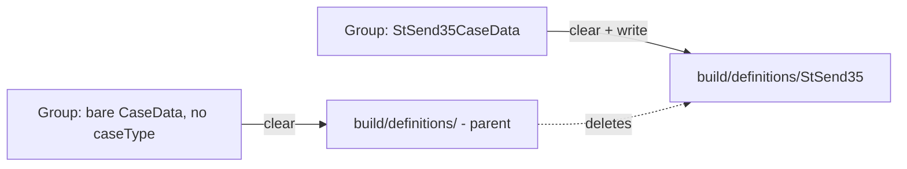
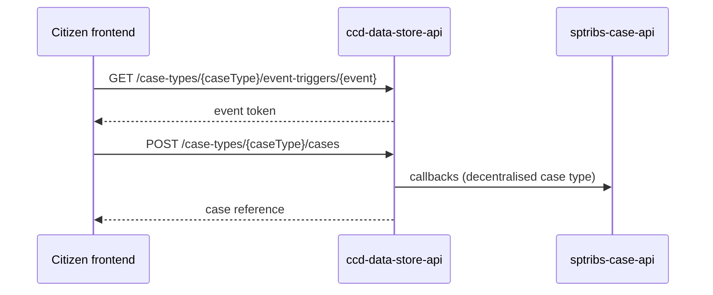

# Adding a case type

This guide explains how to onboard a new tribunal to Special Tribunals as its own CCD case type in `sptribs-case-api`. The service is designed to host several case types side by side. Each tribunal has its own case-data class, state enum and root `CCDConfig`, and the config generator turns each one into a separate CCD definition.

The worked examples are SEND35 (`StSend35`, an appeal about an education, health and care plan) and WPAF1 (`StWpaf1`, a War Pension or Armed Forces Compensation Scheme appeal).

## Before you start: merge the groundwork

The groundwork for a second case type is **not on master yet**. It lives on the [`send35-prototype`](https://github.com/hmcts/sptribs-case-api/tree/send35-prototype) branch, open as draft PR [#2642](https://github.com/hmcts/sptribs-case-api/pull/2642). The `wpaf1-prototype` branch contains all of `send35-prototype` and adds WPAF1 on top. That branch must be merged to master before a new case type can be added.

The groundwork is:

| Change | What it does |
|---|---|
| CIC configs retyped | About 70 CIC configs move from `CCDConfig<CaseData, …>` to `CCDConfig<CriminalInjuriesCompensationData, …>`. All generated CIC definition files are byte-identical before and after. |
| Registry drives registration | `CcdServiceCode` carries the `CcdJurisdiction`. `HighLevelDataSetupApp` and `CftLibConfig` iterate `CcdServiceCode.values()` instead of naming `ST_CIC`. |
| Generic page classes | `PageBuilder` becomes `PageBuilder<T extends CaseData>`, and `CcdPageConfiguration.addTo` becomes `<T extends CaseData> void addTo(PageBuilder<T>)`, so shared page classes work for any case type. |
| `build.gradle` | Derives the case-type IDs from `CcdCaseType` and sets the decentralised URL for each one. Adds a `-PlocalAuth` mode for `bootWithCCD`. |
| `docs/adding-a-case-type.md` | The branch's own version of this guide. |

State of master today:

- [`CriminalInjuriesCompensationData`](../src/main/java/uk/gov/hmcts/sptribs/ciccase/model/casetype/CriminalInjuriesCompensationData.java) exists. It extends `CaseData` and adds no members. Only two configs use it: the root [`CriminalInjuriesCompensation`](../src/main/java/uk/gov/hmcts/sptribs/ciccase/CriminalInjuriesCompensation.java) and [`CICAccessProfile`](../src/main/java/uk/gov/hmcts/sptribs/ciccase/model/accessprofile/CICAccessProfile.java). Every other CIC config is still declared on bare `CaseData`.
- [`CcdCaseType`](../src/main/java/uk/gov/hmcts/sptribs/common/ccd/CcdCaseType.java) and [`CcdServiceCode`](../src/main/java/uk/gov/hmcts/sptribs/common/ccd/CcdServiceCode.java) exist with only the CIC constant. They do not drive registration: `HighLevelDataSetupApp` and `CftLibConfig` refer to `ST_CIC` directly.

**The branch pins an older config-generator than master.** The `hmcts.ccd.sdk` plugin on `send35-prototype` is an older release of the same major version than the one in master's [`build.gradle`](../build.gradle). The branch was cut before master upgraded the plugin; it did not downgrade it. Other differences from master, such as `Jenkinsfile_CNP` and some dependency pins, have the same cause. Before merging, bring master into the branch, keep master's plugin version, regenerate the definitions, check that the CIC definitions are unchanged, and re-run the tests.

## How the generator finds case types

`CCDDefinitionGenerator` in the config generator groups every `CCDConfig` bean in the Spring context by its **case-data class**, which is generic argument 0. It writes one definition directory per group, named after the case-type ID. A case type is therefore the set of configs that share a case-data class. There is no registry of events, no annotation and no wiring: the type parameter is the wiring.

Because every CIC config declares `CriminalInjuriesCompensationData`, the compiler guarantees that a new case type cannot reach CIC's events, and CIC cannot reach the new case type's events.

[`nfdiv-case-api`](https://github.com/hmcts/nfdiv-case-api) is another service that hosts several case types this way.

### Why no config may use bare `CaseData`

The generator clears each group's output directory and then writes it. A group of configs on bare `CaseData` has no root config calling `caseType(...)`, so its case-type ID is `""` and its output directory is `build/definitions/` itself, the parent of every real case-type directory.



With one case type this only leaves loose `*.json` files in `build/definitions/`, which [`bin/ccd-build-definition.sh`](../bin/ccd-build-definition.sh) ignores because it only reads subdirectories. With two case types it deletes output. Spring creates beans in package order, so any case type whose package sorts before `ciccase` is written first and then removed. The symptom is:

```text
FileNotFoundException: build/definitions/<YourCaseType>
```

The generated Java compiles and is correct, which makes the cause hard to spot.

So **never declare a config on bare `CaseData`**. A config added to CIC is declared on `CriminalInjuriesCompensationData`. Shared page classes (`CcdPageConfiguration` implementations) stay on the base class through `<T extends CaseData> void addTo(PageBuilder<T>)`. They are not `CCDConfig` beans, so they form no group.

## Steps

Give the case type its own package. SEND35 lives under `uk.gov.hmcts.sptribs.send35` and WPAF1 under `uk.gov.hmcts.sptribs.wpaf1`.

### 1. Case-data class

1. Create `<YourType>CaseData`. It may extend `CaseData` to inherit the platform fields (case flags, case links, search criteria), or stand alone. The generator keys on the concrete class either way. `StSend35CaseData` and `StWpaf1CaseData` both stand alone.
2. Group the questions into sections. Model each section as a nested class added with `@JsonUnwrapped(prefix = "…")`. The CCD field ID is the prefix followed by the nested field's capitalised `@JsonProperty` name. For example, `@JsonProperty("FirstName")` under prefix `cyp` becomes `cypFirstName`.
3. Keep prefixes short. CCD caps field IDs at **70 characters**. If you reach the limit, shorten the prefix, not the question name.
4. Put `@JsonFormat` on every `LocalDate` so that it serialises as `yyyy-MM-dd`, not as an array.
5. Keep supporting evidence as a plain CCD collection with no prefix.

| Case type | Sections | Prefixes |
|---|---|---|
| `StSend35` | 17 sections, 85 fields | `cyp`, `appellant`, `parents`, `rep`, `adv`, `comms`, `pr`, `appeal`, `school`, `reasons`, `hsc`, `med`, `time`, `other`, `hearing`, `support`, `decl` |
| `StWpaf1` | 10 sections, 49 fields | `app`, `rep`, `apt`, `dsn`, `rsn`, `rec`, `time`, `sup`, `uksf`, `decl` |

The generated `CaseField.json` has one more field than the class, because the SDK adds `caseHistory`. WPAF1 uses `dsn` for the decision so that it is not confused with `decl`.

### 2. State enum

Create a separate enum with a distinct name, such as `StSend35State`. Do not reuse CIC's [`State`](../src/main/java/uk/gov/hmcts/sptribs/ciccase/model/State.java) and do not call yours `State`:

- `generateTypeScript` uses a flat namespace with `mapEnum='asEnum'`, so a second enum called `State` collides in `index.ts`.
- CIC's states carry the hint `### ${cicCaseFullName}`, a CIC field, and several (`Concession`, `Rule27`, `DeathOfAppellant`, `DSS_*`) are CIC-specific.

Both examples have three states: `Submitted`, `Registered` and `Closed`.

### 3. Root config

Create one root config, for example `StSend35CaseTypeConfig implements CCDConfig<StSend35CaseData, StSend35State, UserRole>`. It is the only class that calls `caseType(...)` and `jurisdiction(...)`.

- Take the case type and jurisdiction from your `CcdServiceCode` constant.
- Call `setCallbackHost(System.getenv().getOrDefault("CASE_API_URL", "http://localhost:4013"))`. The service is decentralised, so CCD must call back to it.
- Grant access. `StSend35CaseTypeConfig` grants `CREATE_READ_UPDATE` in all states to `SUPER_USER`, `ST_CIC_CASEWORKER`, `ST_CIC_SENIOR_CASEWORKER`, `ST_CIC_HEARING_CENTRE_ADMIN`, `CITIZEN` and `CREATOR`.

The examples reuse the existing `UserRole` enum and `ST_CIC_*` roles. Neither adds case-type-specific roles or an access-profile class like `CICAccessProfile`. See [roles-and-access.md](roles-and-access.md).

### 4. Events, tabs, search and work basket

Type every class on your case-data class, in your own package.

| Concern | SEND35 class | Notes |
|---|---|---|
| Events | `StSend35CreateCase`, `StSend35RegisterCase`, `StSend35CloseCase` | `create-case` (initial state `Submitted`, granted to `CITIZEN` and caseworkers), then caseworker-only `register-case` (`Submitted` to `Registered`) and `close-case` (`Registered` to `Closed`). |
| Tabs | `StSend35CaseTypeTab` | 13 caseworker tabs. Every question appears on a tab. |
| Search and work basket | `StSend35SearchFields` | Declares all four layouts from one field list, including the `[CASE_REFERENCE]` and `[STATE]` metadata fields. The definition store refuses a case type with an empty layout sheet. |

For general event guidance, see [adding-an-event.md](adding-an-event.md).

### 5. Register the case type

Add one constant to `CcdCaseType` and one to `CcdServiceCode`. Add a `CcdJurisdiction` constant only for a new jurisdiction.

```java
// CcdCaseType: acronym, case-type ID (@JsonValue), description
CIC("CIC", "CriminalInjuriesCompensation", "Criminal Injuries Compensation"),
SEND35("StSend35", "StSend35", "Appeal a decision about an education, health and care (EHC) plan"),

// CcdServiceCode (remaining arguments elided)
ST_SEND35("ST_SEND35", "StSend35", "SEND35", CcdCaseType.SEND35, CcdJurisdiction.CRIMINAL_INJURIES_COMPENSATION, ...),
```

With the groundwork merged, `HighLevelDataSetupApp` and `CftLibConfig` iterate `CcdServiceCode.values()`, so nothing else needs editing to load the definition or seed profiles. `ST_CIC`'s service ID is the HMCTS service code `BBA2`. The new constants use the case-type ID as their service ID, so do not treat that field as a real service code until one is assigned.

### 6. build.gradle

On the groundwork branch, `build.gradle` reads the `CcdCaseType` constants with a regex at configuration time and fails the build if it finds none. For each case-type ID it sets `CCD_DECENTRALISED_CASE-TYPE-SERVICE-URLS_<CaseTypeId>` to `http://localhost:4013` in the `CftlibExec` block. You do not keep a separate list.

Without that entry, CCD treats the case type as centralised. It stores the case in its own database rather than the `sptribs` database, the case never reaches `ccd.es_queue` and is never indexed, and the XUI case list shows nothing.

Append to `XUI_JURISDICTIONS` in `bootWithCCD` and `cftlibTest` only if the jurisdiction is new. [`bin/ccd-build-definition.sh`](../bin/ccd-build-definition.sh) and `buildCCDXlsx` discover definition directories, so they need no change.

`./gradlew bootWithCCD -PlocalAuth` runs the stack without the AAT network: an IDAM simulator, an S2S simulator and local WireMock stubs for the other dependencies. The branch's `README.md` documents it. `cftlibTest` is a separate task and always uses local authentication.

## Jurisdiction: stay in ST_CIC

SEND35 and WPAF1 both use the existing `ST_CIC` jurisdiction (`CcdJurisdiction.CRIMINAL_INJURIES_COMPENSATION`). A new jurisdiction would need its own CCD roles, an `XUI_JURISDICTIONS` entry, and IDAM and user-profile rows for every user. Staying in `ST_CIC` lets the existing roles work unchanged. Whether a production tribunal needs its own jurisdiction is a decision to make when it is onboarded.

## Preview Helm values

Edit [`charts/sptribs-case-api/values.preview.template.yaml`](../charts/sptribs-case-api/values.preview.template.yaml):

| Change | What to add | Why |
|---|---|---|
| Decentralised URL | `CCD_DECENTRALISED_CASE-TYPE-SERVICE-URLS_<CaseTypeId>: https://${SERVICE_FQDN}` beside the `CriminalInjuriesCompensation` entry | Without it, cases are not indexed and do not appear in XUI. |
| User-profile rows | One row per test user, in the form `<user>\|ST_CIC\|<CaseTypeId>\|Submitted` | Without a row, XUI has no default work basket for that user and case type. |
| XUI case types | Add the ID to `CASE_TYPES` for both `xui-webapp` and `xui-mo-webapp` | XUI lists only configured case types. |
| IDAM API URL | Point the global IDAM API URL at `idam-api` (once, not per case type) | `ccd-data-store-api` looks up the acting user with `GET /api/v1/users/{id}`, which `idam-api` serves. |

`Jenkinsfile_CNP` needs no change. Its `onPR` block sets `env.CASE_API_URL` to the PR's service, and the root config passes `CASE_API_URL` to `setCallbackHost`.

## The citizen frontend

The SEND35 and WPAF1 citizen journeys are separate Express and Nunjucks apps: [`sptribs-send-prototype`](https://github.com/hmcts/sptribs-send-prototype) and [`sptribs-wpaf1-prototype`](https://github.com/hmcts/sptribs-wpaf1-prototype). They keep the appeal in the session and create one CCD case when the citizen signs the declaration.



Each call sends the citizen's IDAM token, an S2S token, the exact v2 media type for that call and the `experimental: true` header.

- Name draft properties so that `prefix + CapitalisedProperty` gives the Java field ID. No lookup table is needed.
- In Preview, the frontend PR's `Jenkinsfile_CNP` sets `env.CASE_API_PR` to the case-api PR number and reaches that PR's CCD by its in-cluster hostname, for example `http://sptribs-case-api-pr-2642-ccd-data-store-api`. You need two PRs: one here and one on the frontend.

### Pin the contract with tests

CCD rejects the whole submission on the first unknown field or fixed-list code, without field-level errors. Pin both sides:

| Test | What it pins | Against |
|---|---|---|
| `src/libs/appeal/case-data.test.ts` (SEND35) | Every CCD field ID that the frontend produces | `build/definitions/StSend35/CaseField.json` from this repo |
| `src/libs/appeal/case-type-contract.test.ts` (WPAF1) | Every fixed-list code the journey offers | The `StWpaf1` fixed lists from `./gradlew generateCCDConfig` |

Regenerate the definitions and re-run both whenever either repo changes a field or a list.

## Tests in this repo

Copy the SEND35 suite under `src/test/java/uk/gov/hmcts/sptribs/send35/` on the groundwork branch and change the counts to match your form.

| Test | Asserts |
|---|---|
| `StSend35TestUtil` | Helpers: `configBuilder()`, `ccdFieldIds()`, `unwrappedPrefixes()`, `tabsFrom()` |
| `ccd/StSend35CaseTypeConfigTest` | The case type comes from `CcdServiceCode`, the jurisdiction is `ST_CIC`, the events have the right state flows, and `CITIZEN` can run `create-case` |
| `model/StSend35CaseDataTest` | Field IDs are 70 characters or fewer, prefixes are unique, prefix and field counts match, every section defaults to a non-null object |
| `model/StSend35DateSerializationTest` | Every `LocalDate` has `@JsonFormat` and serialises as `yyyy-MM-dd` |
| `search/StSend35SearchFieldsTest` | Layouts are not empty and reference only existing fields or CCD metadata |
| `tab/StSend35CaseTypeTabTest` | Tabs reference only existing fields, show every question and are granted to caseworkers |

## Not covered yet

The examples do not yet include document upload (CDAM), GOV.UK Notify templates, Work Allocation tasks, Flyway migrations, or definition import beyond Preview. Plan these per tribunal. See [documents-and-bundles.md](documents-and-bundles.md), [adding-a-notification.md](adding-a-notification.md), [adding-a-work-allocation-task.md](adding-a-work-allocation-task.md), [data-and-persistence.md](data-and-persistence.md) and [release-and-deploy.md](release-and-deploy.md).

## Checklist

- [ ] The groundwork from `send35-prototype` is merged to master, with master's config-generator version.
- [ ] `<YourType>CaseData` uses short `@JsonUnwrapped` prefixes, and every field ID is 70 characters or fewer.
- [ ] `<YourType>State` has a distinct name.
- [ ] The root config is the only `caseType()` and `jurisdiction()` call, and it sets `setCallbackHost`.
- [ ] Events, tabs, search and work basket are typed on your case-data class.
- [ ] `CcdCaseType` and `CcdServiceCode` constants are added.
- [ ] Preview values have the decentralised URL, user-profile rows and XUI `CASE_TYPES` in both XUI apps.
- [ ] Tests based on the SEND35 suite pass.
- [ ] The frontend PR's `env.CASE_API_PR` points at your case-api PR, and its contract tests pass against freshly generated definitions.

## Verify

1. Generate the definitions and check that nothing is still on bare `CaseData`:

   ```sh
   ./gradlew generateCCDConfig
   grep -rn 'CCDConfig<CaseData,' src/main/java   # must print nothing
   ls build/definitions/                          # one directory per case type, no loose files
   ```

2. Run `./gradlew bootWithCCD` (or `-PlocalAuth` on the groundwork branch). Create a case through the frontend or XUI on port 3000 and check that it appears in the case list. If it does not, check the decentralised URL for the case type first.
