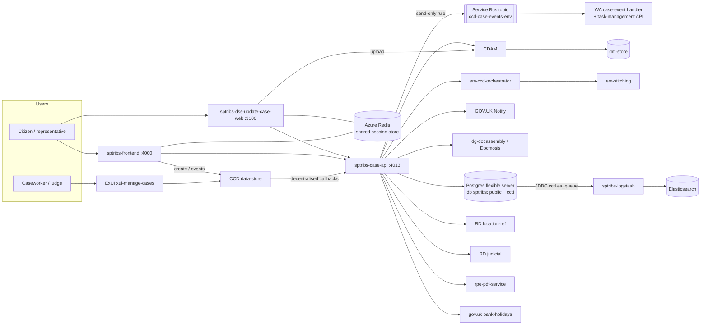

# Architecture

`sptribs-case-api` is the Spring Boot backend for Special Tribunals. It owns the `CriminalInjuriesCompensation` (CIC) case type in the `ST_CIC` jurisdiction, handles every CCD callback for it as a decentralised CCD service, and serves the `/cases/cica/...` endpoints that the citizen apps call. Caseworkers and judges reach it through ExUI and CCD. Citizens reach it through two Node apps. This page describes how those parts fit together and what the service depends on.

In summary:

- One Spring Boot backend (`sptribs-case-api`, port 4013) sits behind ExUI and CCD. Two Node citizen apps sit in front of it: `sptribs-frontend` (port 4000) and `sptribs-dss-update-case-web` (port 3100).
- The service is **decentralised**. CCD data-store routes every callback for the case type to it, and the CCD case tables live in the service's own database.
- The backend calls CDAM, GOV.UK Notify, dg-docassembly (Docmosis), em-ccd-orchestrator (bundling), rpe-pdf-service and Reference Data (location and judicial).
- It publishes case events to the CCD `ccd-case-events-<env>` Service Bus topic, which Work Allocation consumes. It makes no REST calls to Work Allocation.
- Data lives in one Azure Postgres flexible server per environment (`sptribs-<env>-flexible-db-v15`, database `sptribs`). The `public` schema holds the service's Flyway-managed tables. The `ccd` schema holds the CCD case tables.
- A service-owned Logstash reads `ccd.es_queue` and indexes cases into Elasticsearch.

## What the service does

A person refused compensation by the Criminal Injuries Compensation Authority (CICA), or offered less than they expected, can appeal to the First-tier Tribunal. Special Tribunals carries that appeal from the citizen's application, through case building, listing and hearing, to a decision. Caseworkers manage the case in ExUI, judges decide it, and CICA, as respondent, sees the case and its documents.

The case model sits on `CaseData`, with most CIC fields in the `CicCase` complex type. The 21 states are in `State.java`. See [case-lifecycle.md](case-lifecycle.md) for how a case moves between them and [events-reference.md](events-reference.md) for the full event list.

| User | Where they work | Roles |
|---|---|---|
| Citizen (appellant) | `sptribs-frontend` to apply and view documents, `sptribs-dss-update-case-web` to add documents later | `CITIZEN`, plus the `[CREATOR]` case role |
| Legal representative | `sptribs-dss-update-case-web` to upload documents against an existing case | Signs in as an IDAM `citizen` user |
| CICA (respondent) | ExUI | `ST_CIC_RESPONDENT`. The AM role `cica` maps to the `CIC_RESPONDENT` access profile |
| Caseworkers, hearing centre admins and team leaders | ExUI | `ST_CIC_CASEWORKER`, `ST_CIC_SENIOR_CASEWORKER`, `ST_CIC_HEARING_CENTRE_ADMIN`, `ST_CIC_HEARING_CENTRE_TEAM_LEADER` |
| Judges | ExUI | `ST_CIC_JUDGE`, `ST_CIC_SENIOR_JUDGE` |
| System | Scheduled and background events | `SYSTEM_UPDATE` |

See [roles-and-access.md](roles-and-access.md) for the role model.

## Component map

ExUI reaches the service only through CCD data-store. The two Node apps call it directly. Both request their S2S token as `sptribs_case_api` (config `services.authProvider.microservice`, Key Vault secret `s2s-case-api-secret`).

## What "decentralised CCD" means here

The `ccd { }` block in [`build.gradle`](../build.gradle) declares `decentralised = true` and `caseEventServiceBus = true`.

- **Routing.** CCD data-store sends every `CriminalInjuriesCompensation` callback to this service. The target URL comes from the data-store variable `CCD_DECENTRALISED_CASE-TYPE-SERVICE-URLS_CriminalInjuriesCompensation`. In-cluster the host is `sptribs-case-api-<env>.service.core-compute-<env>.internal`.
- **Definition ownership.** The case type is generated from Java with [ccd-config-generator](https://github.com/hmcts/ccd-config-generator). `generateCCDConfig` runs the app in the `config-gen` profile and writes JSON. `buildCCDXlsx` packages it for the definition importer. There is no hand-written definition JSON.
- **Event publishing.** This service, not data-store, publishes case events to Service Bus. A scheduler (`ccd.servicebus.*`: every 10 seconds, batch size 50, published rows kept for 7 days) sends them to `CCD_SERVICEBUS_DESTINATION`.
- **Where case data lives.** The CCD case tables (`case_data`, `case_event`, `es_queue`) are in the `ccd` schema of the `sptribs` database, not in a separate CCD database:
  - The service has one datasource, `jdbc:postgresql://${POSTGRES_HOST}:${POSTGRES_PORT}/${POSTGRES_NAME}` (default database `sptribs`).
  - The config-generator SDK's decentralised runtime runs its own Flyway migrations, which create and manage the `ccd` schema.
  - The service's own migrations (`V1`, `V1.3`, `V1.7`) declare foreign keys to `ccd.case_data(reference)`, which only works because both schemas are in one database.
  - Logstash reads `ccd.es_queue`, `ccd.case_data` and `ccd.case_event` over JDBC.
  - Scheduled tasks query `ccd.case_data` and `ccd.case_event` directly (`CaseEventRepository.getListOfCasesByEventTypeAndDate`).

So the service owns both the logic and the storage for its case type. CCD data-store remains the API surface that ExUI talks to. See [data-and-persistence.md](data-and-persistence.md).

On master, the case-type bean `CriminalInjuriesCompensation` and `CICAccessProfile` are declared on `CriminalInjuriesCompensationData`. The other CIC configs are declared on `CaseData`. Hosting a second case type needs every CIC config moved onto `CriminalInjuriesCompensationData`; see [adding-a-case-type.md](adding-a-case-type.md).

## Code layout

Packages under [`src/main/java/uk/gov/hmcts/sptribs/`](../src/main/java/uk/gov/hmcts/sptribs/):

| Package | Contents |
|---|---|
| `ciccase/` | Case-type root config, `CaseData`, `State`, `UserRole`, access profiles, tabs, search, and the services behind the `/cases/cica/...` endpoints |
| `controllers/` | REST controllers, including `CicaCaseController` for the `/cases/cica/...` endpoints |
| `caseworker/event/` | The 45 caseworker event classes |
| `citizen/event/` | The citizen DSS events |
| `common/event/` | Create, test-create, update-data and reindex events. `common/ccd/` holds `CcdCaseType`, `CcdServiceCode`, `CcdJurisdiction` and the page-builder helpers |
| `systemupdate/event/`, `systemupdate/schedule/` | System events and the scheduled tasks that fire them |
| `notification/` | GOV.UK Notify integration and per-event notification classes |
| `document/` | CDAM, Docmosis and bundling clients |
| `recordlisting/`, `judicialrefdata/`, `bankholidays/` | Reference data and working-day clients |

## Runtime components

| Component | Tech | Port | Notes |
|---|---|---|---|
| `sptribs-case-api` | Java 21, Spring Boot | 4013 | 2 replicas, autoscale to 4. Image `hmctsprod.azurecr.io/sptribs/case-api` |
| `sptribs-frontend` | Node, Express | 4000 | DSS application, CICA lookup, postcode check, citizen dashboard |
| `sptribs-dss-update-case-web` | Node, Express | 3100 | Upload documents against an existing case |
| `sptribs-logstash` | Elastic Logstash chart | n/a | demo, aat, perftest, prod. Not preview |
| `sptribs-cron-*` | This service's image, `sptribs-cron` chart | n/a | Kubernetes CronJobs. `TASK_NAME` picks the Spring task bean |

All workloads run in the `sptribs` namespace and are deployed by Flux from [cnp-flux-config](https://github.com/hmcts/cnp-flux-config/tree/master/apps/sptribs). They use the `sptribs` Azure workload identity, which mounts the `sptribs-<env>` Key Vault.

Each CronJob runs this service's jar with `TASK_NAME=<Task>`. `ScheduledTaskRunner` resolves the bean by name, calls `run()`, and the context then closes. See [scheduled-tasks.md](scheduled-tasks.md).

## Dependencies

| Dependency | How the service reaches it | Config key / env var | Used for |
|---|---|---|---|
| CCD data-store | Inbound callbacks. Outbound for system events | `CASE_DATA_STORE_BASEURL` | Callbacks, and system-update events from scheduled tasks |
| CCD case-assignment | `CaseAssignmentApi` in `CicaRoleService` | via the data-store URL | Grants the citizen `[CREATOR]` on their case |
| CDAM, then dm-store | Feign `CaseDocumentClientApi` (upload, get, binary, delete) | `CASE_DOCUMENT_AM_BASEURL` | All document storage. `DOCUMENT_MANAGEMENT_URL` is set but documents go through CDAM |
| GOV.UK Notify | `NotificationClient` | `UK_GOV_NOTIFY_API_KEY_1` (secret `uk-gov-notify-api-key`) | Emails and letters, templates under `uk.gov.notify.email.templatesCIC` |
| rpe-pdf-service | `PDFServiceClient` | `PDF_API_URL` | Correspondence PDFs filed to CDAM |
| dg-docassembly (Docmosis) | Feign `DocAssemblyClient` | `DOC_ASSEMBLY_URL` | Orders and decision notices from `ST-CIC-*` templates |
| em-ccd-orchestrator, then em-stitching | `BundlingService` | `BUNDLING_API_URL` | Case bundles from `bundleconfiguration/*.yaml` |
| RD location-ref | Feign `LocationClient` | `LOCATION_API_URL` | Hearing venues and regions |
| RD judicial | Feign `JudicialClient` | `JUDICIAL_API_URL` | Judicial user lookups (page size 200) |
| gov.uk bank holidays | Feign `BankHolidaysApi` | fixed URL (`scotland.json`) | Working-day deadlines, cached for 180 days |
| IDAM and S2S | `idam-java-client`, `AuthTokenGenerator` | `IDAM_API_BASEURL`, `S2S_URL` | User and system-update tokens. S2S as `sptribs_case_api` |
| Work Allocation | Service Bus topic only | `CCD_SERVICEBUS_DESTINATION` | Task initiation, completion and cancellation through the DMNs in [`src/main/resources/dmn/`](../src/main/resources/dmn/) |
| LaunchDarkly | SDK | `LAUNCH_DARKLY_SDK_KEY` | Feature flag client |
| Postgres | JDBC, JPA, Flyway | `POSTGRES_HOST`, `POSTGRES_PORT` (default 6432), `POSTGRES_NAME` (default `sptribs`) | Service tables and the `ccd` schema |

The service has no AM Role Assignment client. CCD and ExUI read AM role assignments. There is no HMC or List Assist integration: hearings are recorded only in case data (see [hearings.md](hearings.md)).

Letters go through GOV.UK Notify. `NotificationServiceCIC.sendLetter()` calls `NotificationClient.sendLetter()`, and Notify prints and posts the letter. `SEND_LETTER_SERVICE_BASEURL` is set in configuration but no code reads it. See [notifications.md](notifications.md).

The service holds a send-only rule (`sptribs-sendonly`) on CCD's topic. Work Allocation consumes the topic and evaluates the `wa-task-*-st_cic-criminalinjuriescompensation.dmn` files, which the Jenkins pipeline uploads to Camunda. See [work-allocation.md](work-allocation.md).

### Services that call this service

`S2S_AUTHORISED_SERVICES` in [`charts/sptribs-case-api/values.yaml`](../charts/sptribs-case-api/values.yaml) lists the callers:

| Caller | Why |
|---|---|
| `ccd_data` | Event callbacks |
| `ccd_definition` | Definition-store calls |
| `ccd_gw` | CCD gateway |
| `xui_webapp` | ExUI |
| `sptribs_case_api` | Itself, and both citizen apps, which lease tokens under this name |
| `sptribs_frontend`, `sptribs_dss_update_case_web` | Listed for the citizen apps |

The `application.yaml` default is shorter: `ccd_data,sptribs_frontend,sptribs_dss_update_case_web`.

## Citizen apps

Both Node apps sign citizens in with IDAM OIDC (`/login`, then `/receiver`), keep sessions in one shared Azure Redis per environment, and send the user's token plus an S2S token on every backend call. Both offer Welsh through `?lng=cy`.

| App | Calls to this service (`SPTRIBS_CASE_API_URL`) | Other calls |
|---|---|---|
| [sptribs-frontend](https://github.com/hmcts/sptribs-frontend) | `GET /cases/cica/{ref}/access`, and the dashboard document list and download (`/cases/CIC/{ref}/documents...`) with an `X-Postcode` header | CCD data-store for the DSS events: `citizen-cic-create-dss-application` creates the case in `DSS_Draft`, `citizen-cic-update-dss-application` saves later pages, and `citizen-cic-submit-dss-application` moves it to `DSS_Submitted`. Data-store then calls this service back |
| [sptribs-dss-update-case-web](https://github.com/hmcts/sptribs-dss-update-case-web) | `GET /cases/cica/{id}/access`, `POST /cases/cica/{id}/subject-verifications`, `POST /cases/cica/{id}/updates` (the `citizen-cic-dss-update-case` event) | Uploads directly to CDAM (`POST /cases/documents`) |

The update-case journey asks for a 16-digit case reference, verifies the subject's name and date of birth, takes the uploads and then submits. The `/cases/cica/...` services call `CicaRoleService.ensureCreatorRole()`, which adds the `[CREATOR]` case role so the citizen can open the case.

A scheduled task, `SystemClearInactiveDssDraftCasesTask`, moves drafts not modified for 30 days or more to `DSS_Expired`.

## Search: Logstash to Elasticsearch

The `sptribs-logstash` release runs two pipelines:

- `main`: a JDBC input polls `ccd.es_queue` every second, 100 rows at a time. It joins to `ccd.case_data` and the latest `ccd.case_event`. Events with `SearchCriteria` are also written to the `global_search` index. Other events go to `<case_type_id>_cases`.
- `index-dead-letter-to-es`: indexes failures into `ccd-logstash-dead-letter`.

Global search exposes one criterion, the CICA reference (`cicCaseCicaReferenceNumber`).

## Shared Azure infrastructure

[sptribs-shared-infrastructure](https://github.com/hmcts/sptribs-shared-infrastructure) is Terraform only. It supplies:

| Resource | Name pattern | Notes |
|---|---|---|
| Key Vault | `sptribs-<env>` | Holds the service's secrets |
| App Insights | `sptribs-appinsights` | AAT also has a preview instance |
| Alerts | action group `sptribs-ag1` | Exceptions-per-second alert in aat, demo, perftest and prod |
| Postgres flexible server | `sptribs-<env>-flexible-db-v15` | Runs PostgreSQL 16. Database `sptribs`, reader access on schemas `public` and `ccd` |
| Service Bus rule | `sptribs-sendonly` on `ccd-case-events-<env>` | The namespace `ccd-servicebus-<env>` belongs to CCD |

Secrets the vault holds, by name, include `s2s-case-api-secret`, `ccd-importer-username`, `ccd-importer-password`, `docmosis-access-key`, `sptribs-POSTGRES-USER`, `sptribs-POSTGRES-PASS` and `ccd-case-events-sendonly-connection-string` (surfaced as `AZURE_SERVICE_BUS_CONNECTION_STRING`). See [configuration.md](configuration.md).

Preview is different. A PR deployment gets its own CCD stack and a `pr-<CHANGE_ID>-sptribs-case-api` database on `sptribs-preview`. The pipeline imports the generated definition into the PR's own definition store. See [release-and-deploy.md](release-and-deploy.md).

## Related repositories

| Repository | Purpose |
|---|---|
| [sptribs-frontend](https://github.com/hmcts/sptribs-frontend) | Citizen DSS application, CICA lookup, postcode check and document dashboard |
| [sptribs-dss-update-case-web](https://github.com/hmcts/sptribs-dss-update-case-web) | Citizen and representative document upload against an existing case |
| [sptribs-e2etests](https://github.com/hmcts/sptribs-e2etests) | Playwright suite for the citizen journeys and caseworker flows, including Work Allocation |
| [sptribs-shared-infrastructure](https://github.com/hmcts/sptribs-shared-infrastructure) | Terraform for the Key Vault, App Insights, Postgres and the Service Bus rule |
| [sptribs-send-prototype](https://github.com/hmcts/sptribs-send-prototype) | Citizen prototype for the SEND35 case type (Preview only) |
| [sptribs-wpaf1-prototype](https://github.com/hmcts/sptribs-wpaf1-prototype) | Citizen prototype for the WPAF1 case type (Preview only) |
| [cnp-flux-config](https://github.com/hmcts/cnp-flux-config/tree/master/apps/sptribs) | Flux releases for the apps, Logstash and cron jobs |

Platform components this service relies on: [ccd-data-store-api](https://github.com/hmcts/ccd-data-store-api), [ccd-definition-store-api](https://github.com/hmcts/ccd-definition-store-api), [ccd-case-document-am-api](https://github.com/hmcts/ccd-case-document-am-api), [em-ccd-orchestrator](https://github.com/hmcts/em-ccd-orchestrator), [rse-cft-lib](https://github.com/hmcts/rse-cft-lib) (for `bootWithCCD` and `cftlibTest`), and the Work Allocation and AM services.

## Multiple case types

Special Tribunals is also the platform for bringing more First-tier Tribunal jurisdictions onto CCD. Each one becomes its own case type in this service, with its own citizen journey. The first two prototypes, SEND35 (`StSend35`) and WPAF1 (`StWpaf1`), are on branches only. See [adding-a-case-type.md](adding-a-case-type.md).
