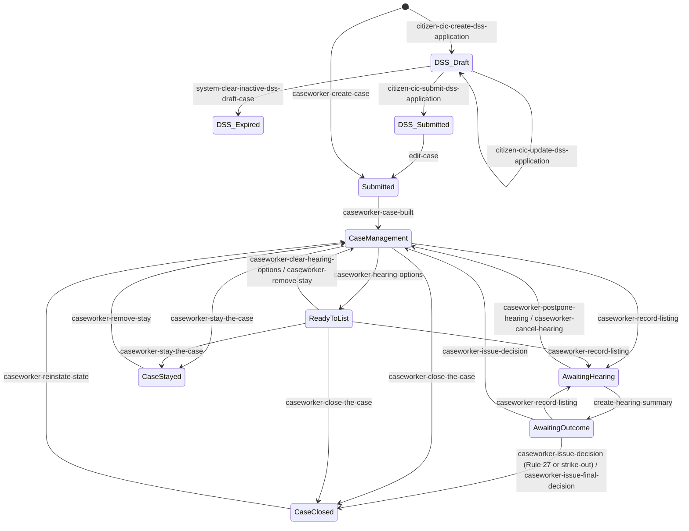

# CIC case lifecycle

This page explains how a `CriminalInjuriesCompensation` case moves through its states, from the citizen's draft to closure. It covers the state diagram, the business stages and the events that drive each move. For the complete list of events with their grants and callbacks, see [events-reference.md](events-reference.md).

In summary:

- The case type (jurisdiction `ST_CIC`) has 21 states, declared in the [`State`](../src/main/java/uk/gov/hmcts/sptribs/ciccase/model/State.java) enum.
- A citizen starts the case through the DSS journey. `citizen-cic-create-dss-application` puts it in `DSS_Draft`, and `citizen-cic-submit-dss-application` moves it to `DSS_Submitted`.
- A caseworker's first `edit-case` moves the case from `DSS_Submitted` to `Submitted`. Caseworkers then build the case (`caseworker-case-built`, to `CaseManagement`), list a hearing (`caseworker-record-listing`, to `AwaitingHearing`), record the hearing summary (`create-hearing-summary`, to `AwaitingOutcome`) and issue a decision.
- Postponing or cancelling a hearing returns the case to `CaseManagement`. Stays are added and lifted with `caseworker-stay-the-case` and `caseworker-remove-stay`.
- Closure ends in `CaseClosed`. `caseworker-reinstate-state` moves a closed case back to `CaseManagement`.
- Hearings live only in CCD case data. There is no HMC or List Assist integration (see [hearings.md](hearings.md)).

## How the lifecycle is enforced

Each event is a Spring bean. It declares its event ID, its from-states and to-state, its grants and its callbacks through the ccd-config-generator SDK. CCD rejects an event if the case is not in one of the declared from-states. Many events declare only `forStates(...)` and set the new state in their `aboutToSubmit` response, so the to-state is in the callback, not the event config. The service is decentralised, so CCD sends every `aboutToStart`, `aboutToSubmit` and `submitted` callback for this case type to `sptribs-case-api`.

Events sit in three main packages:

| Package | Who triggers | Grant pattern |
|---|---|---|
| [`citizen/event/`](../src/main/java/uk/gov/hmcts/sptribs/citizen/event/) | Citizens, through `sptribs-frontend` and `sptribs-dss-update-case-web` | `CITIZEN` and `CREATOR` (CRU on create, CRUD on update and DSS update). Submit also grants CRU to `SYSTEM_UPDATE` and `ST_CIC_WA_CONFIG_USER`, and history to staff roles |
| [`caseworker/event/`](../src/main/java/uk/gov/hmcts/sptribs/caseworker/event/) | Caseworkers, legal officers and judges in ExUI | Varies per event. Usually the `ST_CIC_*` staff roles |
| [`systemupdate/event/`](../src/main/java/uk/gov/hmcts/sptribs/systemupdate/event/) | Scheduled tasks and background jobs, run as the system-update user | `CREATE_READ_UPDATE_DELETE` to `SYSTEM_UPDATE`. The WA trigger events also grant CRU to `ST_CIC_WA_CONFIG_USER` |

A fourth package, [`common/event/`](../src/main/java/uk/gov/hmcts/sptribs/common/event/), holds caseworker case creation, test-case creation, data update and reindex events.

## States

The 21 values of `State`, by CCD ID:

`Completed`, `Rejected`, `Sent`, `Withdrawn`, `AwaitingHearing`, `AwaitingOutcome`, `CaseClosed`, `Concession`, `CaseManagement`, `CaseStayed`, `StrikeOut`, `ConsentOrder`, `DeathOfAppellant`, `Draft`, `DSS_Draft`, `DSS_Expired`, `DSS_Submitted`, `NewCaseReceived`, `ReadyToList`, `Rule27`, `Submitted`.

No event in the normal lifecycle moves a case into `Completed`, `Rejected`, `Sent`, `Withdrawn`, `Concession`, `StrikeOut`, `ConsentOrder`, `Rule27`, `DeathOfAppellant` or `NewCaseReceived`. Some events list them as from-states (for example the document-management and contact-parties events), but nothing sets them as a to-state. The `CloseReason` enum pairs each close reason with a matching `State` name, but `caseworker-close-the-case` always sets `CaseClosed` and stores the reason in `closeCase.closeCaseReason`. `create-test-case` can set any state, for test data.

## State diagram

The diagram shows every declared state move. Events that leave the state unchanged, such as notes, flags, documents, orders and bundles, are left out.

## Business stages

### 1. Submission (citizen, DSS)

| Event ID | Class | From, to | Notes |
|---|---|---|---|
| `citizen-cic-create-dss-application` | `CicCreateCaseEvent` | new, to `DSS_Draft` | The config declares `initialState(Draft)`, and `aboutToSubmit` returns `DSS_Draft`. It also sets `hyphenatedCaseRef`, `isRepresentativePresent`, and the default location and category. `submitted` sends a supplementary-data request to CCD |
| `citizen-cic-update-dss-application` | `CicUpdateCaseEvent` | `Draft`, `Submitted`, `DSS_Draft` (no move) | Saves draft edits |
| `citizen-cic-submit-dss-application` | `CicSubmitCaseEvent` | `DSS_Draft` to `DSS_Submitted` | Formal submission. A `DSS_Expired` case cannot be submitted |
| `citizen-cic-dss-update-case` | `CicDssUpdateCaseEvent` | every state except `DSS_Expired` (no move) | Lets a citizen or representative upload documents against an existing case |

Citizens hold the case role `[CREATOR]` on their case. `CicaRoleService.ensureCreatorRole()` adds it through the CCD case-assignment API if it is missing. See [roles-and-access.md](roles-and-access.md).

`system-clear-inactive-dss-draft-case` (`SystemClearInactiveDssDraftCase`) moves `DSS_Draft` to `DSS_Expired`. `SystemClearInactiveDssDraftCasesTask` runs it on a schedule. It searches for cases in `DSS_Draft` whose `last_modified` is 30 or more days ago and fires the event on each. Only unsubmitted citizen drafts expire. See [scheduled-tasks.md](scheduled-tasks.md).

`State.POST_SUBMISSION_STATES` groups every state except `Draft`, `Withdrawn` and `Rejected`. It includes `DSS_Draft` and `DSS_Expired`.

### 2. Case management

| Event ID | Class | From, to |
|---|---|---|
| `edit-case` | `CaseworkerEditCase` | `DSS_Submitted` to `Submitted`. From `Submitted`, `CaseManagement`, `ReadyToList`, `AwaitingHearing` and `AwaitingOutcome` it keeps the current state |
| `caseworker-case-built` | `CaseworkerCaseBuilt` | `Submitted` to `CaseManagement` |
| `caseworker-hearing-options` | `CaseworkerHearingOptions` | `CaseManagement`, `ReadyToList` to `ReadyToList` |
| `caseworker-clear-hearing-options` | `CaseworkerClearHearingOptions` | `ReadyToList` to `CaseManagement` |
| `refer-to-judge` | `CaseWorkerReferToJudge` | `CaseManagement`, `ReadyToList`, `AwaitingHearing`, `AwaitingOutcome`, `CaseClosed`, `CaseStayed` (no move) |
| `refer-to-legal-officer` | `CaseWorkerReferToLegalOfficer` | same states as `refer-to-judge` (no move) |
| `caseworker-stay-the-case` | `CaseworkerStayTheCase` | `CaseManagement`, `ReadyToList`, `CaseStayed` to `CaseStayed` |
| `caseworker-remove-stay` | `CaseworkerRemoveStay` | `CaseStayed`, `ReadyToList` to `CaseManagement` |
| `createBundle` | `CaseworkerCreateBundle` | `CaseManagement`, `AwaitingHearing`, `ReadyToList`, `CaseClosed` (no move) |

`edit-case` calls `SubmissionService.submitApplication()` and returns the state the case was in before the event, except that `DSS_Submitted` becomes `Submitted`.

`caseworker-case-built` grants CRU to `SUPER_USER`, `ST_CIC_CASEWORKER`, `ST_CIC_SENIOR_CASEWORKER`, `ST_CIC_HEARING_CENTRE_ADMIN`, `ST_CIC_HEARING_CENTRE_TEAM_LEADER`, `ST_CIC_SENIOR_JUDGE` and `ST_CIC_WA_CONFIG_USER`. `ST_CIC_JUDGE` gets history only. `edit-case` grants CRU to the same roles plus `ST_CIC_RESPONDENT`, and also gives `ST_CIC_JUDGE` history only.

`createBundle` calls em-ccd-orchestrator through `BundlingService`, and `asyncStitchingComplete` records the result. `system-trigger-stitch-collate-hearing-bundle` can also prompt stitching from a scheduled task for `AwaitingHearing` cases with a hearing in the next 14 days. See [documents-and-bundles.md](documents-and-bundles.md).

### 3. Listing and hearings

| Event ID | Class | From, to |
|---|---|---|
| `caseworker-record-listing` | `CaseworkerRecordListing` | `CaseManagement`, `ReadyToList`, `AwaitingOutcome` to `AwaitingHearing` |
| `caseworker-edit-record-listing` | `CaseworkerEditRecordListing` | `AwaitingHearing` (no move) |
| `caseworker-postpone-hearing` | `CaseworkerPostponeHearing` | `AwaitingHearing` to `CaseManagement` |
| `caseworker-cancel-hearing` | `CaseworkerCancelHearing` | `AwaitingHearing` to `CaseManagement` when a hearing is selected |
| `create-hearing-summary` | `CaseWorkerCreateHearingSummary` | `AwaitingHearing` to `AwaitingOutcome` |
| `edit-hearing-summary` | `CaseWorkerEditHearingSummary` | `AwaitingOutcome`, `CaseClosed` (no move) |

`caseworker-record-listing` fills the hearing data in `aboutToSubmit`. The venue comes from `rd-location-ref-api` through `LocationClient`. The listing is stored only in case data (date, time, venue, hearing type and format).

`create-hearing-summary` grants CRU to `ST_CIC_CASEWORKER`, `ST_CIC_SENIOR_CASEWORKER`, `ST_CIC_HEARING_CENTRE_ADMIN`, `ST_CIC_HEARING_CENTRE_TEAM_LEADER`, `ST_CIC_SENIOR_JUDGE` and `ST_CIC_WA_CONFIG_USER`. Its `aboutToSubmit` fills `HearingOutcome` and sets `AwaitingOutcome`.

`system-trigger-complete-hearing-outcome` runs from a scheduled task on `AwaitingHearing` cases whose hearing date is today and whose `completeHearingOutcomeTask` is not yet `Yes`. It sets that flag to `Yes` so Work Allocation can create a task. It does not change the state.

### 4. Orders and decisions

| Event ID | Class | From, to |
|---|---|---|
| `create-and-send-order` | `CaseworkerCreateAndSendOrder` | no move. Generates the order in `aboutToSubmit` and sends it in `submitted` |
| `caseworker-send-order` | `CaseworkerSendOrder` | no move. Sends a draft order to the parties |
| `caseworker-edit-draft-order`, `caseworker-delete-draft-order` | `CaseworkerEditDraftOrder`, `CaseworkerDeleteDraftOrder` | no move |
| `caseworker-issue-decision` | `CaseworkerIssueDecision` | `AwaitingOutcome` to `CaseClosed` if the notice uses the Rule 27 or strike-out template, otherwise to `CaseManagement` |
| `caseworker-issue-final-decision` | `CaseworkerIssueFinalDecision` | `AwaitingOutcome` to `CaseClosed` |

`create-hearing-summary` moves the case from `AwaitingHearing` to `AwaitingOutcome`. Then `caseworker-issue-decision` or `caseworker-issue-final-decision` moves it out of `AwaitingOutcome`.

Grants differ per event. `caseworker-issue-decision`, `caseworker-issue-final-decision` and `create-and-send-order` grant CRU to `ST_CIC_JUDGE` and `ST_CIC_SENIOR_JUDGE` alongside caseworker roles. `caseworker-send-order` grants CRU only to `ST_CIC_HEARING_CENTRE_ADMIN`, `ST_CIC_HEARING_CENTRE_TEAM_LEADER` and `ST_CIC_WA_CONFIG_USER`. Orders and decision notices are rendered by dg-docassembly from Docmosis templates such as `ST-CIC-DEC-ENG-CIC1_Eligibility` and `ST-CIC-DEC-ENG-CIC3_Rule_27`, stored in CDAM, and sent to the parties by GOV.UK Notify email or letter. See [documents-and-bundles.md](documents-and-bundles.md) and [notifications.md](notifications.md).

### 5. Closure and reinstatement

| Event ID | Class | From, to |
|---|---|---|
| `caseworker-close-the-case` | `CaseworkerCloseTheCase` | `CaseManagement`, `ReadyToList` to `CaseClosed` |
| `caseworker-reinstate-state` | `ReinstateCase` | `CaseClosed` to `CaseManagement` |

A case is closed for a reason (withdrawn, rejected, strike-out, concession, consent order, Rule 27 or death of appellant), and it always lands in `CaseClosed`. `caseworker-reinstate-state` is the only way back. It grants CRU to the caseworker and hearing-centre roles and `ST_CIC_SENIOR_JUDGE`, and gives `ST_CIC_JUDGE` history only. Its `submitted` callback sends a case-reinstated notification.

## Who can see each state

Each `State` value has a `@CCD` annotation with one or more access classes:

- **`DefaultStateAccess`** (`CREATOR` read): `Completed`, `Rejected`, `Sent` and `Withdrawn`.
- **`DefaultStateAccessExcludingCAA`** (`CREATOR` read, `SYSTEM_UPDATE` CRU): the other 17 states.
- **`CaseworkerRASValidationAccess`** (`caseworker-ras-validation` read): every state except `DeathOfAppellant` and `DSS_Expired`.
- **`GlobalSearchAccess`**: every state except `DeathOfAppellant` and `DSS_Expired`. It gives `GS_profile` read, so these states appear in global search.
- **`CaseworkerWithCAAAccess`** (`ST_CIC_JUDGE` and `ST_CIC_RESPONDENT` CRU): `ReadyToList` only.
- **`SolicitorAccess`** (`caseworker` CRU): `Draft` only.

Read each access class by its grants. The "CAA" (case access administrator) naming follows a shared CCD service pattern; this service has no CAA role.

Event grants decide who can trigger an event. AM role assignments decide who holds which role on a case. `CICAccessProfile` maps role-assignment roles (for example `cica` to `CIC_RESPONDENT`) to CCD access profiles. See [roles-and-access.md](roles-and-access.md).

## Work Allocation side effects

Events marked `.publishToCamunda()` are published to the `ccd-case-events-<env>` Service Bus topic. Work Allocation then evaluates the DMNs under [`src/main/resources/dmn/`](../src/main/resources/dmn/). The task-initiation DMN keys on `eventId`, `postEventState`, `referralType`, `adminActionRequired` and `firstOrderDueDate`. For example, `create-draft-order` with a post-event state of `CaseManagement` or `ReadyToList` and a referral type of "Withdrawal request" creates `processCaseWithdrawalDirections`. In `AwaitingHearing` the same input creates `processCaseWithdrawalDirectionsListed`. So the same event can create different tasks depending on the state it lands in.

The DMNs match the exact `EventConstants` IDs, such as `create-draft-order`, `refer-to-judge`, `refer-to-legal-officer` and `caseworker-case-built`. `caseworker-issue-decision` and `caseworker-cancel-hearing` appear only in the cancellation and completion DMNs. See [work-allocation.md](work-allocation.md).

## See also

- [events-reference.md](events-reference.md): every event with its states, grants and callbacks
- [roles-and-access.md](roles-and-access.md): who can trigger each event and see each state
- [work-allocation.md](work-allocation.md): how events create tasks
- [adding-an-event.md](adding-an-event.md): how to add a new event
