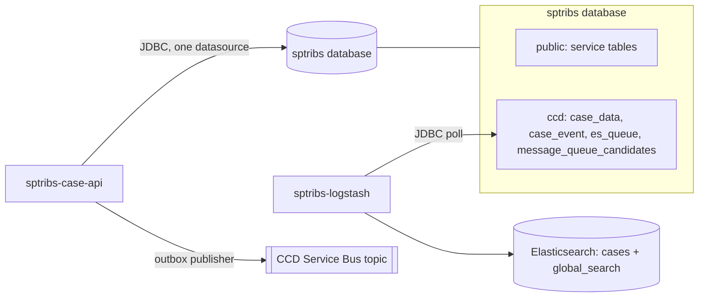

# Data and persistence

This page describes where Special Tribunals data is stored, which tables this service owns, how cases are indexed for search, and how data is retained and backed up. In summary:

- Data lives in one Azure PostgreSQL flexible server per environment (`sptribs-<env>-flexible-db-v15`, running PostgreSQL 16), database `sptribs`, with a `public` and a `ccd` schema.
- `sptribs-case-api` is a decentralised CCD service. Its CCD case data, event history and indexing queue live in the `ccd` schema of the `sptribs` database. Logstash reads `ccd.case_data`, `ccd.case_event` and `ccd.es_queue` over JDBC and indexes into Elasticsearch, including the `global_search` index.
- The service's own tables are created by Flyway migrations `V1` to `V1.7`: `case_correspondences`, `case_document_types`, `case_documents`, `correspondence_document` and `document_download_status`, plus the `anonymisation_global_seq` sequence and a `party` enum type.
- Citizen sessions for `sptribs-frontend` and `sptribs-dss-update-case-web` are held in Azure Managed Redis, with a file store in `/tmp` as a fallback when no Redis host is set.
- The only clean-up job deployed is `SystemClearInactiveDssDraftCasesTask`, which moves DSS drafts untouched for 30 days to `DSS_Expired`. Published Service Bus records in `ccd.message_queue_candidates` are deleted after 7 days by the SDK's publisher.
- Geo-redundant backups are on in prod only.

## The database

[`sptribs-shared-infrastructure`](https://github.com/hmcts/sptribs-shared-infrastructure) provisions the database in `postgres.tf` with the `terraform-module-postgresql-flexible` module.

| Property | Value |
|---|---|
| Server name | `${var.product}-${var.env}-flexible-db-v15`, for example `sptribs-aat-flexible-db-v15` |
| Engine | PostgreSQL 16. The `v15` in the name is historical. |
| Database | `var.database-name`, default `sptribs` |
| Schemas | `public` and `ccd`, both listed in `schemas_for_reader_access` |
| SKU and storage | `pgsql_sku` default `GP_Standard_D2ds_v4`. `pgsql_storage_mb` default 65536 (64 GB). `auto_grow_enabled = true` |
| Server settings | `pg_stat_statements` and `pg_buffercache` enabled. `log_lock_waits` and query capture on. Server log download on, with `logfiles.retention_days = 7` |
| Subnet | `subnet_suffix = "expanded"` |
| Credentials | The module generates the server's login and password. `tf-key-vault.tf` writes them to Key Vault as `sptribs-POSTGRES-USER` and `sptribs-POSTGRES-PASS` |

The case API connects with the settings in [`application.yaml`](../src/main/resources/application.yaml): `${POSTGRES_HOST:localhost}:${POSTGRES_PORT:6432}/${POSTGRES_NAME:sptribs}`, plus `${POSTGRES_CONNECTION_OPTIONS:}`, as `POSTGRES_USERNAME` and `POSTGRES_PASSWORD`. There is one datasource, so the service's tables and the `ccd` schema are reached over the same connection. The Helm chart ([`charts/sptribs-case-api/values.yaml`](../charts/sptribs-case-api/values.yaml)) maps the Key Vault secrets `sptribs-POSTGRES-HOST`, `-PORT`, `-DATABASE`, `-USER` and `-PASS` onto those environment variables. The cron jobs inject the same secrets.

Preview is different. [`values.preview.template.yaml`](../charts/sptribs-case-api/values.preview.template.yaml) points at the shared preview Postgres server and creates a database per PR, named `pr-${CHANGE_ID}-sptribs-case-api`.

## CCD case data

The `ccd { decentralised = true }` block in [`build.gradle`](../build.gradle) registers the `CriminalInjuriesCompensation` case type (jurisdiction `ST_CIC`) as decentralised. CCD routes the case type to this service through `CCD_DECENTRALISED_CASE-TYPE-SERVICE-URLS_CriminalInjuriesCompensation`.

For this case type, the case data, the event history and the indexing queue sit in the `ccd` schema of the `sptribs` database, not in the CCD data store's database:

- The `sptribs` database has a `ccd` schema next to `public`, and Terraform grants reader access on it.
- The case API has a single datasource, and [`CaseEventRepository`](../src/main/java/uk/gov/hmcts/sptribs/common/repositories/CaseEventRepository.java) queries `ccd.case_data` and `ccd.case_event` over it with plain SQL.
- The Flyway migrations `V1`, `V1.3` and `V1.7` declare foreign keys to `ccd.case_data(reference)` with `on delete cascade`.
- The sptribs Logstash reads `ccd.case_data`, `ccd.case_event` and `ccd.es_queue` itself.
- The SDK's Service Bus publisher reads and deletes rows in `ccd.message_queue_candidates` over the same datasource.

In practice this means:

- Data fixes, retention and backups for case data are the service's responsibility, on the server described above.
- Search indexing depends on the sptribs Logstash release. If it stops, cases are saved but are not searchable.
- The service can query case and event history in SQL as well as through CCD search.
- Because of the cascading foreign keys, deleting a row from `ccd.case_data` also deletes that case's correspondence, document and download-status rows.

## The service's own tables

Flyway migrations live in [`src/main/resources/db/migration/`](../src/main/resources/db/migration/), and Flyway runs on start-up with Spring Boot's defaults. It is turned off for `generateCCDConfig`, which sets `SPRING_FLYWAY_ENABLED=false` in `build.gradle` and runs against an in-memory H2 database. It is also turned off (`spring.flyway.enabled: false`) in `application-functional.yaml` and `application-integration.yaml`. `spring.flyway.out-of-order: true` is set, so a migration with a lower version can be applied after a higher one. The migrations create their tables in the default `public` schema.

| Migration | Creates or changes |
|---|---|
| `V1__create_correspondence_table.sql` | Table `case_correspondences`: `case_reference_number` (FK to `ccd.case_data(reference)`, cascade delete), `id` (uuid), `event_type`, `sent_on`, `sent_from`, `sent_to`, `document_url`, `document_binary_url`, `document_filename`, `correspondence_type`. Primary key `(case_reference_number, id)` |
| `V1.1__create_anonymisation_sequence.sql` | Sequence `anonymisation_global_seq`, starting at 1 and incrementing by 1 |
| `V1.2__create_documents_type_table.sql` | Lookup table `case_document_types` (`id`, unique `code`, `name`, `description`), seeded with 10 rows |
| `V1.3__create_documents_table.sql` | Table `case_documents`: identity `id`, `case_reference_number` (FK to `ccd.case_data(reference)`, cascade delete), `saved_at`, `document_url`, unique `document_binary_url`, `document_filename`, `document_type_name`, `case_document_type_id` (FK to `case_document_types`), `updated_at` |
| `V1.4__create_document_indexes.sql` | One index, `idx_case_docs_case_ref_type_saved_at`, on `case_documents (case_reference_number, case_document_type_id, saved_at DESC)` |
| `V1.5__alter_case_correspondences.sql` | Creates the enum type `party` (`APPLICANT`, `REPRESENTATIVE`, `RESPONDENT`, `SUBJECT`, `TRIBUNAL`). Adds a unique constraint `uq_correspondence_id` on `case_correspondences.id` and a nullable column `receiving_party party` |
| `V1.6__create_correspondence_document_table.sql` | Join table `correspondence_document`: `document_id` (FK to `case_documents`, cascade delete) and `correspondence_id` (FK to `case_correspondences(id)`, cascade delete). Primary key `(document_id, correspondence_id)` |
| `V1.7__create_document_download_status_table.sql` | Table `document_download_status`: identity `id`, `case_reference_number` (FK to `ccd.case_data(reference)`, cascade delete), `document_id` (FK to `case_documents`, cascade delete), `party` (`party` enum, not null), `downloaded_at`. Unique on `(document_id, party)`, with indexes `idx_doc_download_case_party` and `idx_doc_download_doc_id` |

To add a migration, add the next `V<version>__<description>.sql` file to the same folder. Flyway applies it on the next start-up.

### Correspondence

`NotificationServiceCIC` writes a [`CorrespondenceEntity`](../src/main/java/uk/gov/hmcts/sptribs/notification/persistence/CorrespondenceEntity.java) through [`CorrespondenceRepository`](../src/main/java/uk/gov/hmcts/sptribs/common/repositories/CorrespondenceRepository.java) after each GOV.UK Notify email or letter. Its columns are:

- `id`, the Notify notification UUID
- `event_type`, the template name
- `case_reference_number`
- `sent_on`, `sent_from`, `sent_to`
- `correspondence_type` (`Email` or `Letter`)
- `receiving_party` (the `party` enum)
- `document_url`, `document_binary_url`, `document_filename`

For both emails and letters, a PDF copy is generated and uploaded to CDAM, and the row points to that PDF. Email rows set `receiving_party`. Letter rows, written by `saveLetterCorrespondence`, leave it null. The entity's primary key is `(id, case_reference_number)`. See [notifications](notifications.md).

### Documents and document types

`case_documents` holds metadata for documents that are stored in CDAM: `case_reference_number`, `saved_at`, `document_url`, `document_binary_url` (unique), `document_filename`, `document_type_name` and `case_document_type_id`. The binaries stay in CDAM and dm-store, not in Postgres. `correspondence_document` links documents to the correspondence they were sent with. `document_download_status` records, per document and party, when that party downloaded it.

`case_document_types` is a lookup table. V1.2 seeds these rows:

| id | code | name | description |
|---|---|---|---|
| 1 | `APPLICATION` | Application | Document saved through citizen journey |
| 2 | `DOCUMENT_MANAGEMENT` | Document Management | Document saved through document management |
| 3 | `ORDER` | Order | Document via create and send order |
| 4 | `DRAFT_ORDER` | Draft Order | Document from save order |
| 5 | `DECISION` | Decision | Decision on case |
| 6 | `FINAL_DECISION` | Final Decision | Final decision on case |
| 7 | `HEARING_RECORD` | Hearing Record | Audio from the listening on the hearing |
| 8 | `CORRESPONDENCE` | Correspondence | Documents sent out as correspondence |
| 9 | `BUNDLE` | Bundle | Stitched bundle from bundle event |
| 10 | `OTHER` | Other | Other |

Older cases have document references only in the case data JSON. `SystemMigrateCaseDocumentsDocumentTableTask` copies those references into `case_documents`. It only runs when `feature.migrate-to-documents-table-task.enabled` (`MIGRATE_CASE_DOCUMENTS_TO_TABLE_ENABLED`) is true. Its cron directory, `sptribs-cron-migrate-case-documents-to-doc-table` (`0 12 * * *`), is still in `cnp-flux-config`, but no environment kustomization references it, so it is a retired one-off. See [documents and bundles](documents-and-bundles.md).

### Anonymisation sequence

`anonymisation_global_seq` gives each anonymised case a unique value. `AnonymisationService` uses it when anonymity is applied.

## Redis for the citizen apps

[`sptribs-frontend`](https://github.com/hmcts/sptribs-frontend) keeps its express-session store in Redis, set up in `src/main/modules/session/index.ts`.

- `REDIS_HOST` and `REDIS_PORT` map to `session.redis.host` and `session.redis.port`. The Helm chart sets `REDIS_HOST` to `sptribs-frontend-<env>.uksouth.redis.azure.net` and `REDIS_PORT` to `10000`.
- The instance is Azure Managed Redis, created by the frontend's `infrastructure/main.tf` in aat, demo, ithc, perftest and prod, with a private endpoint.
- The access key comes from the Key Vault secret `redis-new`, aliased to `redis-access-key` in Helm.
- The connection uses TLS and has a 15-second connect timeout.
- The session cookie is `sptribs-frontend-session`, with a 21-minute max age and `rolling: true`.
- If no Redis host is set, as in most local runs, the store falls back to a file store in `/tmp`.

[`sptribs-dss-update-case-web`](https://github.com/hmcts/sptribs-dss-update-case-web) uses the same instance and the same `redis-new` secret. Its session module follows the same pattern: TLS, Redis store and a `/tmp` file-store fallback. Its cookie is `sptribs-dss-update-case-web-session`, with a `session.maxAge` of 1260000 ms (21 minutes). Neither app sets a store key prefix, so both write to the default `sess:` key space.

Redis holds only session state, which is transient. Case data is never stored there.

## Elasticsearch, global search and Logstash

The sptribs Logstash is defined in [`cnp-flux-config`](https://github.com/hmcts/cnp-flux-config) as the HelmRelease `sptribs-logstash` (`apps/sptribs/sptribs-logstash/sptribs-logstash.yaml`). It uses the Elastic `logstash` chart in the `sptribs` namespace. It is deployed in demo, AAT, perftest and prod.

- **Connection.** The JDBC input uses `${SPTRIBS_DB_URL}`, `${SPTRIBS_DB_USER}` and `${SPTRIBS_DB_PASS}` from the SOPS-encrypted `logstash-secret` in each environment. It connects to the `sptribs` database.
- **Driver.** An init step downloads the PostgreSQL JDBC driver into an `emptyDir` mounted at `/usr/share/logstash/ccd`.
- **Input.** The `main` pipeline polls every second. It selects up to 100 rows from `ccd.es_queue` in `enqueued_at` order with `FOR UPDATE SKIP LOCKED` and deletes them in the same statement. It then joins each one to `ccd.case_data` (matching `case_revision`) and to the latest `ccd.case_event`.
- **Global search.** A filter clones each event that carries the `SearchCriteria` field. The clone's fields are renamed to `data_new`, `supplementary_data_new` and `data_classification_new`. The service defines [`SearchCriteria`](../src/main/java/uk/gov/hmcts/sptribs/ciccase/search/SearchCriteria.java).
- **Output.** Each document goes to the index named by `%{[index_id]}`. Clones go to `global_search` and ordinary case documents go to `<case_type_id>_cases`.
- **Dead letters.** A second pipeline, `index-dead-letter-to-es`, writes failed events to the index `ccd-logstash-dead-letter`.

`es_queue` is a queue table that Logstash drains. A backlog there means that search and work-basket results lag behind saved data. Rows are deleted from `es_queue` when they are read. Documents that Elasticsearch rejects go to the dead-letter index. Logstash's persisted queue covers restarts between reading and writing. The `SystemMigrateGlobalSearchTask` migration exists to backfill global search data on existing cases.

## Retention and clean-up

All scheduled jobs run the case-api image with a `TASK_NAME` environment variable through the `sptribs-cron` chart. See [scheduled tasks](scheduled-tasks.md) for the full list.

| Job | Task | Schedule | Environments | What it does |
|---|---|---|---|---|
| `clear-inactive-dss-draft-cases` | [`SystemClearInactiveDssDraftCasesTask`](../src/main/java/uk/gov/hmcts/sptribs/systemupdate/schedule/migration/SystemClearInactiveDssDraftCasesTask.java) | Base `0 17 * * 1-5`; cluster 00 patches set `0 9 * * *` | demo, AAT, ITHC, perftest, prod | Expires abandoned citizen DSS drafts. It searches through CCD Elasticsearch for cases in state `DSS_Draft` whose `last_modified` is on or before today minus 30 days. It submits `SYSTEM_CLEAR_INACTIVE_DSS_DRAFT_CASE` for each one, which moves the case from `DSS_Draft` to `DSS_Expired`. The case is not deleted. |
| `clean-further-documents` | `SystemCleanDeletedDocumentsTask` | `0/10 * * * *` in the base manifest; the prod patch sets `30 12 * * *` | None (retired) | Finds cases that have a `caseworker-remove-document` event created on or after 1 October 2025 and a non-empty `furtherUploadedDocuments` array. It submits `SYSTEM_CLEAN_DELETED_DOCUMENTS` for each one. |

`SystemCleanDeletedDocumentsTask` only runs when `feature.clean-deleted-documents-task.enabled` (`CLEAN_DELETED_DOCUMENTS_ENABLED`, default `false`) is true. `feature.clean-deleted-documents-task.caseReference` limits it to a single case for testing.

**Service Bus retention.** The case API publishes case events to the CCD topic `ccd-case-events-<env>` in batches. This is the config-generator SDK's `ccd-servicebus-support` module, enabled by `caseEventServiceBus = true`. The batch size is `SPTRIBS_SERVICEBUS_BATCH_SIZE` (default 50) and the schedule is `SPTRIBS_SERVICEBUS_SCHEDULE` (default every 10 seconds). The outbox rows live in `ccd.message_queue_candidates`. Publishing sets their `published` timestamp. At the end of each scheduled run, `CcdCaseEventPublisher` deletes rows of its message type whose `published` is older than `SPTRIBS_SERVICEBUS_PUBLISHED_RETENTION_DAYS` days. This service sets that to 7, overriding the SDK default of 90. The service has a send-only rule (`sptribs-sendonly`) on the CCD topic.

Nothing purges `case_correspondences`, `case_documents`, `correspondence_document` or `document_download_status` on a schedule. Their rows are removed by the cascade when the parent `ccd.case_data` row is deleted.

## Backups

| Environment | Geo-redundant backups |
|---|---|
| prod | On: `postgres_geo_redundant_backups = true` in `prod.tfvars` |
| All others | Off: the variable defaults to `false` |

`postgres.tf` does not set `backup_retention_days`, so the module default of 35 days applies. Restores use the Azure flexible-server point-in-time restore. The CCD case data for this case type sits in the `ccd` schema of the same database, so those backups cover it as well.

## Access to the data

- The case API and its cron jobs read the database credentials from the `sptribs-<env>` Key Vault through the `sptribs` workload identity.
- Logstash connects with the credentials in its SOPS-encrypted `logstash-secret`.
- Platform PostgreSQL admin groups and the Jenkins identity are Entra admins on the server, as set by the shared Terraform module.
- An Entra DB reader group gets read access on the `public` and `ccd` schemas.

For live-service database queries and incident steps, see the [support runbook](support-runbook.md).

## See also

- [Architecture](architecture.md): where the database, Logstash and Service Bus sit among the other components
- [Work allocation](work-allocation.md): how the outbox publishes events to the Service Bus topic
- [Configuration](configuration.md): settings and secrets for database access
- [Documents and bundles](documents-and-bundles.md): how `case_documents` relates to CDAM, Docmosis and bundling
- [Notifications](notifications.md): what writes `case_correspondences`
- [Scheduled tasks](scheduled-tasks.md): every cron job, its `TASK_NAME` and schedule
