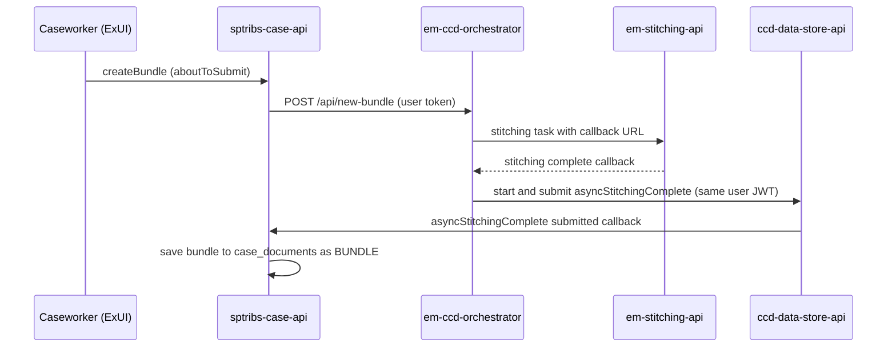

# Documents, orders and bundles

This page explains how `sptribs-case-api` stores documents, generates orders and decision notices, anonymises the subject, and builds hearing bundles. In summary:

- Every document is stored in CDAM ([`ccd-case-document-am-api`](https://github.com/hmcts/ccd-case-document-am-api)), not in dm-store directly. The service talks to it through the `CaseDocumentClientApi` Feign client. Both citizen web apps upload to CDAM themselves.
- Orders and decision notices are rendered by `dg-docassembly` (Docmosis) through `DocAssemblyClient`. Template names are configured in `application.yaml`. The `.docx` template files live in [`hmcts/rdo-docmosis`](https://github.com/hmcts/rdo-docmosis), not in this repo.
- Anonymisation gives the subject a generated letter code (`AA`, `AB`, …) from the `anonymisation_global_seq` Postgres sequence (Flyway `V1.1`). `AnonymisationService` stores it in `anonymisedAppellantName`, and the order and decision templates print it in place of the subject's name.
- Hearing bundles are stitched by `em-ccd-orchestrator`, which loads the bundle YAML from **its own** `bundleconfiguration/` folder. When stitching finishes, em-ccd-orchestrator submits the `asyncStitchingComplete` CCD event. The `SystemTriggerStitchCollateHearingBundleTask` cron creates a Work Allocation task to collate a bundle ahead of a hearing.
- Service-owned Postgres tables (Flyway `V1` to `V1.7`) hold correspondence and document metadata. Several system events migrated legacy document data into them. Their crons are retired.

## Where documents live

`sptribs-case-api` never holds document binaries. CDAM stores them, and CCD case data (plus the service's own Postgres tables) holds references.

| Concern | Component | Config / symbol |
|---|---|---|
| Document storage and access | CDAM | `case_document_am.url` ← `CASE_DOCUMENT_AM_BASEURL` |
| Order and decision generation | `dg-docassembly` (Docmosis) | `doc_assembly.url` ← `DOC_ASSEMBLY_URL` |
| Bundle stitching | `em-ccd-orchestrator` | `bundling.api.baseUrl` ← `BUNDLING_API_URL` |
| Correspondence PDFs | `rpe-pdf-service` | `PDF_API_URL` |

Both `dg-docassembly` and `em-ccd-orchestrator` include `sptribs_case_api` in their `S2S_NAMES_WHITELIST`. CDAM lists `sptribs_case_api` in `CASE_DOCUMENT_S2S_AUTHORISED_SERVICES`. The two Node citizen apps also get their S2S token as `sptribs_case_api`, so CDAM accepts their calls under the same name.

## CDAM uploads and downloads

[`CaseDocumentClientApi`](../src/main/java/uk/gov/hmcts/sptribs/services/cdam/CaseDocumentClientApi.java) exposes four operations:

| Method | Purpose |
|---|---|
| `uploadDocuments(AUTHORIZATION, SERVICE_AUTHORIZATION, DocumentUploadRequest)` | `POST /cases/documents`. Returns `UploadResponse` with the document URLs |
| `deleteDocument(documentId, permanent)` | `DELETE /cases/documents/{documentId}`. `permanent=true` cannot be undone |
| `getDocument(documentId)` | `GET /cases/documents/{documentId}`. Fetches metadata (URL, binary URL, filename, size) |
| `getDocumentBinary(documentId)` | `GET /cases/documents/{documentId}/binary`. Fetches the bytes |

Every call carries both a user token and an S2S token from `AuthTokenGenerator`. [`DocumentDownloadService`](../src/main/java/uk/gov/hmcts/sptribs/document/DocumentDownloadService.java) serves the citizen download endpoint. It calls `ensureCreatorRole` again after a 404 from CDAM. `DocumentUtil` holds static helpers for validating file formats, converting document lists and setting categories.

Uploads made by the case API itself use `Classification.RESTRICTED`. These are the correspondence PDFs in `NotificationServiceCIC`, the audio/video evidence cover document in `AudioVideoEvidenceBundleService`, and test-case documents. Both citizen apps upload with `classification: PUBLIC`. CDAM checks that the classification is a valid value and passes it to dm-store. Read access comes from the case the document is attached to.

`spring.servlet.multipart` allows uploads of up to 500MB (`max-file-size` and `max-request-size`) on the case API.

### Caseworker document events

Caseworkers manage documents in ExUI through these events:

| Event ID | Class | What it does |
|---|---|---|
| `caseworker-document-management` | `CaseworkerDocumentManagement` | Adds documents. `aboutToSubmit` converts the uploads, sets their categories and, when bundle ordering is enabled, adds them to `furtherUploadedDocuments` |
| `caseworker-amend-document` | `CaseworkerDocumentManagementAmend` | Amends document metadata |
| `caseworker-remove-document` | `CaseworkerDocumentManagementRemove` | Removes a document |

The documents appear on the `caseDocuments`, `orders`, `bundles`, `correspondence` and `caseFileView` tabs (`CaseTypeTab`).

### Document categories and types

Two separate enums classify documents, and they answer different questions.

[`CaseDocumentType`](../src/main/java/uk/gov/hmcts/sptribs/document/model/CaseDocumentType.java) says *where a document came from*. It mirrors the `case_document_types` rows seeded by Flyway `V1.2` one for one, and `DocumentsService` writes it to `case_documents.case_document_type_id`:

| Id (`case_document_types`, V1.2) | Code | Seed description |
|---|---|---|
| 1 | `APPLICATION` | Document saved through citizen journey |
| 2 | `DOCUMENT_MANAGEMENT` | Document saved through document management |
| 3 | `ORDER` | Document via create and send order |
| 4 | `DRAFT_ORDER` | Document from save order |
| 5 | `DECISION` | Decision on case |
| 6 | `FINAL_DECISION` | Final decision on case |
| 7 | `HEARING_RECORD` | Audio from the listening on the hearing |
| 8 | `CORRESPONDENCE` | Documents sent out as correspondence |
| 9 | `BUNDLE` | Stitched bundle from bundle event |
| 10 | `OTHER` | Other |

[`DocumentType`](../src/main/java/uk/gov/hmcts/sptribs/document/model/DocumentType.java) is the CIC *document category* that caseworkers pick in ExUI, such as "B - Police evidence". It has 34 values. Each one carries a `label`, a `type` and a short `category` code, and the code becomes the CCD `category_id` on the document link:

| Category code | Meaning |
|---|---|
| `A` | Application documents (application form, first decision, review, notice of appeal, appellant and CICA correspondence) |
| `B` | Police evidence |
| `C` | Medical records (GP, hospital, mental health, expert, other medical) |
| `D` | Financial records (DWP, HMRC, employment, schedule of loss, counter schedule, other) |
| `E` | Other evidence (care plan, local authority or care records, other) |
| `L` | Linked documents |
| `S` | Witness statements |
| `TD` | Tribunal direction and decision notices. `DocAssemblyService` gives every generated order or decision this category |
| `TG` | General evidence (extension of time, postponement, submissions, other) |
| `CD` | Correspondence documents |
| `DSS` | Documents uploaded through the citizen DSS journeys |

The bundle configuration filters on these category codes, not on the `CaseDocumentType` names. See [hearing bundles](#hearing-bundles-em-ccd-orchestrator).

## Orders and decision notices (dg-docassembly / Docmosis)

### Flow

1. A caseworker or judge runs an order or decision event in ExUI. The main ones are `create-and-send-order` (`CaseworkerCreateAndSendOrder`), `caseworker-issue-decision` and `caseworker-issue-final-decision`. Drafts are handled by `caseworker-edit-draft-order` and `caseworker-delete-draft-order`, and sending a draft by `caseworker-send-order`.
2. The callback calls `DocAssemblyService.renderDocument()` ([`DocAssemblyService`](../src/main/java/uk/gov/hmcts/sptribs/document/DocAssemblyService.java)).
3. [`DocmosisTemplateProvider`](../src/main/java/uk/gov/hmcts/sptribs/document/content/DocmosisTemplateProvider.java)`.templateNameFor(templateId, languagePreference)` looks up the Docmosis file name in the `docmosis.templates` map from `application.yaml`, keyed by language and template ID.
4. `DocAssemblyService` builds a `DocAssemblyRequest` and calls `DocAssemblyClient.generateAndStoreDraftApplication()`. The request contains:
   - `templateId`: the Docmosis template file name, including `.docx`
   - `outputType`: `PDF`
   - `caseTypeId`: `CriminalInjuriesCompensation`
   - `jurisdictionId`: `ST_CIC`
   - `formPayload`: a JSON tree of case data
   - `secureDocStoreEnabled`: `true`
5. dg-docassembly renders the PDF and stores it in CDAM. `DocAssemblyResponse.renditionOutputLocation` returns the CDAM URL. The case API wraps it in a `DocumentInfo` with category `TD` and records the reference in case data.

Rendering is synchronous within the callback, so a slow render can time out the event.

### Templates configured in application.yaml

`docmosis.templates.english` in [`application.yaml`](../src/main/resources/application.yaml) holds 18 entries. The key is the template ID the code asks for, and the value is the file name in `hmcts/rdo-docmosis` (all under `Templates/Base/`). There are two families:

| Config key | rdo-docmosis file | Use |
|---|---|---|
| `ST-CIC-DEC-ENG-CIC1_Eligibility` | `ST-CIC-DEC-ENG-CIC1_Eligibility.docx` | Eligibility decision |
| `ST-CIC-DEC-ENG-CIC2_Quantum` | `ST-CIC-DEC-ENG-CIC2_Quantum.docx` | Quantum decision |
| `ST-CIC-DEC-ENG-CIC3_Rule_27` | `ST-CIC-DEC-ENG-CIC3_Rule_27.docx` | Rule 27 decision |
| `ST-CIC-DEC-ENG-CIC4_Blank_Decision_Notice` | `ST-CIC-DEC-ENG-CIC4_Blank_Decision_Notice.docx` | Blank decision notice |
| `ST-CIC-DEC-ENG-CIC6_General_Directions` | `ST-CIC-DEC-ENG-CIC6_General_Directions.docx` | General directions |
| `ST-CIC-DEC-ENG-CIC7_ME_Dmi_Reports` | `ST-CIC-DEC-ENG-CIC7_ME_Dmi_Reports.docx` | Medical evidence: DMI reports |
| `ST-CIC-DEC-ENG-CIC8_ME_Joint_Instruction` | `ST-CIC-DEC-ENG-CIC8_ME_Joint_Instruction.docx` | Medical evidence: joint instruction |
| `ST-CIC-DEC-ENG-CIC10_Strike_Out_Warning` | `ST-CIC-DEC-ENG-CIC10_Strike_Out_Warning.docx` | Strike-out warning |
| `ST-CIC-DEC-ENG-CIC11_Strike_Out_Decision_Notice` | `ST-CIC-DEC-ENG-CIC11_Strike_Out_Decision_Notice.docx` | Strike-out decision notice |
| `ST-CIC-DEC-ENG-CIC12_Decision_Annex` | `ST-CIC-DEC-ENG-CIC12_Decision_Annex.docx` | Decision annex |
| `ST-CIC-DEC-ENG-CIC13_Pro_Forma_Summons` | `ST-CIC-DEC-ENG-CIC13_Pro_Forma_Summons.docx` | Pro forma summons |
| `CIC3_Rule_27` | `ST-CIC-STD-ENG-CIC3_Rule_27.docx` | Rule 27 (standard order) |
| `CIC6_General_Directions` | `ST-CIC-STD-ENG-CIC6_General_Directions.docx` | General directions (standard order) |
| `CIC7_ME_Dmi_Reports` | `ST-CIC-STD-ENG-CIC7_ME_Dmi_Reports.docx` | DMI reports (standard order) |
| `CIC8_ME_Joint_Instruction` | `ST-CIC-STD-ENG-CIC8_ME_Joint_Instruction.docx` | Joint instruction (standard order) |
| `CIC10_Strike_Out_Warning` | `ST-CIC-STD-ENG-CIC10_Strike_Out_Warning.docx` | Strike-out warning (standard order) |
| `CIC13_Pro_Forma_Summons` | `ST-CIC-STD-ENG-CIC13_Pro_Forma_Summons.docx` | Pro forma summons (standard order) |
| `CIC14_LO_General_Directions` | `ST-CIC-STD-ENG-CIC14_Legal_Officer_General_Directions.docx` | Legal officer general directions (standard order) |

The `ST-CIC-DEC-ENG-*` keys come from the `DecisionTemplate` enum (decision notices, plus `CIC12_Decision_Annex` through `DocumentConstants`). The `CIC*` keys come from the `OrderTemplate` enum (orders, which use the `ST-CIC-STD-ENG-*` files). rdo-docmosis also holds two bundle cover pages, `ST-CIC-ASS-ENG-Cover-Page.docx` and `ST_CIC_CoverPage.docx`. em-ccd-orchestrator uses these through the bundle YAML, not `DocAssemblyService`.

The config holds English templates only. No Welsh Docmosis templates are configured, although Notify has Welsh template entries.

The config value must match the template file name in Docmosis exactly, or rendering fails. The `formPayload` field names must also match the template fields, or the PDF renders with blanks.

### Where the template files live

The `.docx` files are in [`hmcts/rdo-docmosis`](https://github.com/hmcts/rdo-docmosis) under `Templates/Base/`, with every other team's Docmosis templates. If you add a new field, change both repos: the template in `rdo-docmosis` and the `formPayload` built in `sptribs-case-api`.

## Anonymisation

- Anonymity is switched on or off by `caseworker-update-anonymity` (`CaseworkerUpdateAnonymity`) and by the case-flag events (`CaseworkerCaseFlag`, `CaseworkerManageCaseFlag`). Applying it also adds an anonymity case flag, and removing it sets that flag to `Inactive`.
- [`AnonymisationService`](../src/main/java/uk/gov/hmcts/sptribs/common/service/AnonymisationService.java)`.applyAnonymitySelection()` does the work. When `anonymiseYesOrNo` is `Yes` and the case has no anonymised name yet, it takes the next value of `anonymisation_global_seq` (Flyway `V1.1`). It turns the value into a letter code: 1 is `AA`, 26 is `AZ`, 676 is `ZZ` and 677 is `AAA`. The code is stored in `cicCase.anonymisedAppellantName`, along with `anonymisationDate`. Once set, the code is kept even if anonymity is later switched off.
- Generated documents use the code by substitution. `DecisionTemplateContent`, `FinalDecisionTemplateContent` and `PreviewDraftOrderTemplateContent` set the `subjectFullName` field in the Docmosis payload to `anonymisedAppellantName` when anonymity is on, and to the subject's real name otherwise. Other payload fields, such as representative names, are passed to Docmosis unchanged.
- Notify has an `ANONYMITY_APPLIED` notification (`AnonymityAppliedNotification`), sent when anonymity is newly applied. See [notifications](notifications.md).

## Hearing bundles (em-ccd-orchestrator)

### Configuration

[`CaseworkerCreateBundle`](../src/main/java/uk/gov/hmcts/sptribs/caseworker/event/CaseworkerCreateBundle.java) sets the case's `bundleConfiguration` and `multiBundleConfiguration` to `st_cic_bundle_all_case.yaml` (`BundlingConstants.BUNDLE_FILE_NAME`). em-ccd-orchestrator resolves that name from its own classpath (`LocalConfigurationLoader` reads `bundleconfiguration/<filename>`). So the layout that runs is [`em-ccd-orchestrator/src/main/resources/bundleconfiguration/st_cic_bundle_all_case.yaml`](https://github.com/hmcts/em-ccd-orchestrator/blob/master/src/main/resources/bundleconfiguration/st_cic_bundle_all_case.yaml). Changing it needs an em-ccd-orchestrator release, not a case API one.

That file sets `title: CIC Bundle`, `coverpageTemplate: ST-CIC-ASS-ENG-Cover-Page.docx`, a table of contents, coversheets and folder coversheets, and sorts by `/date`. Each folder filters `/caseDocuments` on `/documentLink/category_id`, which is the `DocumentType` category code:

| Folder | Filter |
|---|---|
| Application Documents | `A` |
| Police evidence | `B` |
| Medical records | `C` |
| Financial records | `D` |
| Other evidence | `E` |
| Linked documents | `L` |
| Witness Statements | `S` |
| Direction - decision notices | `TD` |
| General evidence | `TG` |
| Further Documents | `/furtherCaseDocuments`, filtered on the same nine codes |
| Audio/video evidence documents | `/audioVideoEvidenceBundleDocument` (single document) |

Documents in categories `CD` (correspondence) and `DSS` match no folder, so they are left out of the bundle.

This repo also has a [`src/main/resources/bundleconfiguration/`](../src/main/resources/bundleconfiguration/) folder with `st_cic_bundle_all_case.yaml` and `bundle.yaml`. em-ccd-orchestrator does not read either file. Edit the copy in em-ccd-orchestrator to change the bundle layout.

### Events

| Event ID | Class | Who | Notes |
|---|---|---|---|
| `createBundle` | `CaseworkerCreateBundle` | Caseworkers, senior caseworkers, hearing centre admin and team leaders, WA config user, super user | States `CaseManagement`, `AwaitingHearing`, `ReadyToList`, `CaseClosed`. Calls em-ccd-orchestrator `POST /api/new-bundle` through `BundlingService`, passing the user's token |
| `cloneBundle` | `CaseworkerCloneBundle` | Super user only | States `CaseManagement`, `AwaitingHearing`. Copies an existing bundle |
| `removeBundles` | `CaseworkerRemoveBundles` | Hearing centre admin and team leaders, super user | States `CaseManagement`, `AwaitingHearing`. Clears bundles |
| `asyncStitchingComplete` | `CaseworkerBundleStitchComplete` | Same caseworker roles as `createBundle` (not `SYSTEM_UPDATE`) | Hidden event. Its `submitted` callback saves the latest stitched document to `case_documents` as `BUNDLE` |
| `system-trigger-stitch-collate-hearing-bundle` | `SystemTriggerStitchCollateHearingBundle` | `SYSTEM_UPDATE` (WA config user has CRU) | Sets `stitchHearingBundleTask = Yes` and publishes to Camunda |

em-ccd-orchestrator calls em-stitching-api to merge the PDFs. It also adds the table of contents and renders the cover page through Docmosis. Stitching is asynchronous:

1. em-ccd-orchestrator's `AutomatedStitchingExecutor` gives the stitching task a callback URL, `/api/stitching-complete-callback/{caseId}/asyncStitchingComplete/{bundleId}`, along with the JWT from the original `createBundle` request.
2. When em-stitching-api finishes, it calls that URL. `StitchingCompleteCallbackService` then starts and submits the `asyncStitchingComplete` event through CCD data-store, using the same user JWT.

So the event runs as the caseworker who created the bundle, which is why it grants caseworker roles rather than `SYSTEM_UPDATE`. The stitched bundle appears on the `bundles` tab after `asyncStitchingComplete` has run, not when `createBundle` finishes. A missing cover page template or an unreadable PDF makes stitching fail.

### Collate-bundle cron

[`SystemTriggerStitchCollateHearingBundleTask`](../src/main/java/uk/gov/hmcts/sptribs/systemupdate/schedule/wa/SystemTriggerStitchCollateHearingBundleTask.java) runs as a Kubernetes CronJob, with `TASK_NAME=SystemTriggerStitchCollateHearingBundleTask`. It:

1. Searches as the system-update user for cases in `AwaitingHearing` where `stitchHearingBundleTask` is not `Yes` and `data.hearingList.value.date` is within the next 14 days.
2. Submits `system-trigger-stitch-collate-hearing-bundle` for each one. The event sets `stitchHearingBundleTask` to `Yes`, so each case is picked up only once. It is published to Camunda, and the WA DMNs create a `stitchCollateHearingBundle` task from it.
3. Logs a per-case `CcdManagementException` or `IllegalArgumentException` and carries on with the next case. A `CcdSearchCaseException` or `CcdConflictException` from the search stops the whole run.

The Flux release `sptribs-cron-trigger-stitch-hearing-bundle` runs on `0 8 * * 1-5` (08:00, Monday to Friday). It is deployed to demo and AAT only, not prod. See [work allocation](work-allocation.md) and [scheduled tasks](scheduled-tasks.md).

## Document tables and migration events

### Flyway tables

Migrations are in [`src/main/resources/db/migration/`](../src/main/resources/db/migration/). `flyway.out-of-order` is `true`. Tables reference `ccd.case_data(reference)` with `on delete cascade`.

| Migration | Creates or changes |
|---|---|
| `V1__create_correspondence_table.sql` | `case_correspondences`: `case_reference_number`, `id` (the Notify notification id), `event_type`, `sent_on`, `sent_from`, `sent_to`, `document_url`, `document_binary_url`, `document_filename`, `correspondence_type` |
| `V1.1__create_anonymisation_sequence.sql` | `anonymisation_global_seq` |
| `V1.2__create_documents_type_table.sql` | `case_document_types` lookup, seeded with the ten `CaseDocumentType` rows above |
| `V1.3__create_documents_table.sql` | `case_documents`: case reference, `saved_at`, CDAM URLs (binary URL unique), filename, `document_type_name`, `case_document_type_id` |
| `V1.4__create_document_indexes.sql` | Index on `case_documents (case_reference_number, case_document_type_id, saved_at DESC)` |
| `V1.5__alter_case_correspondences.sql` | Creates the `party` enum and adds `case_correspondences.receiving_party` and a unique constraint on `id` |
| `V1.6__create_correspondence_document_table.sql` | `correspondence_document` join table between `case_documents` and `case_correspondences` |
| `V1.7__create_document_download_status_table.sql` | `document_download_status`: per-party `downloaded_at` for each document |

[`NotificationServiceCIC`](../src/main/java/uk/gov/hmcts/sptribs/notification/NotificationServiceCIC.java) renders every sent email and letter to PDF through `rpe-pdf-service`, using the `sent_notification.html` template. It uploads the PDF to CDAM as `RESTRICTED` with category `CD`, then writes a `case_correspondences` row with `correspondence_type` set to `Email` or `Letter`. See [data and persistence](data-and-persistence.md).

### System events and cron jobs

| Cron (Flux release) | `TASK_NAME` → event ID | Deployed to | Schedule in base manifest |
|---|---|---|---|
| `sptribs-cron-migrate-case-documents-to-doc-table` | `SystemMigrateCaseDocumentsDocumentTableTask` → `migrate-to-document-table` | None (retired) | `0 12 * * *` |
| `sptribs-cron-system-migrate-initial-docs` | `SystemMigrateInitialCaseDocumentsTask` → `migrate-initial-case-documents` | None (retired) | `0/10 * * * *` |
| `sptribs-cron-system-restore-orders` | `SystemRestoreOrdersTask` → `system-restore-orders` | None (retired) | `0/10 * * * *` |
| `sptribs-cron-clean-further-documents` | `SystemCleanDeletedDocumentsTask` → `system-clean-deleted-documents` | None (retired) | `0/10 * * * *` |

No environment kustomization references these four cron directories. They are one-off migrations kept in the repo. The events grant CRUD to `SYSTEM_UPDATE`, and `migrate-to-document-table` also grants it to `SUPER_USER`. The tasks run as the system-update IDAM user.

`SystemMigrateCaseDocumentsDocumentTableTask` is controlled by `feature.migrate-to-documents-table-task.enabled` (`MIGRATE_CASE_DOCUMENTS_TO_TABLE_ENABLED`) and `.caseReference`. With no case reference, it takes every case outside `DSS_Draft`, `Draft` and `DSS_Expired`. For each case, the `migrate-to-document-table` event (`SystemMigrateCaseDocumentsToDocTable`) writes every document and every stitched bundle to `case_documents` through `DocumentsService`. It doesn't touch the correspondence table. Its batch size and pause are read from the `feature.migrate-initial-case-documents-task.*` properties.

`SystemCleanDeletedDocumentsTask` is controlled by `feature.clean-deleted-documents-task.enabled` (`CLEAN_DELETED_DOCUMENTS_ENABLED`) and `.caseReference`. It finds cases with a `caseworker-remove-document` event on or after 1 October 2025, then submits `system-clean-deleted-documents` for each one.

## Citizen uploads

### sptribs-dss-update-case-web (DSS Update Case)

Citizens and representatives upload documents against an existing case through [`sptribs-dss-update-case-web`](https://github.com/hmcts/sptribs-dss-update-case-web):

1. **Case finder** (`/dss-update/casefinder`): enter the 16-digit case reference. The app calls `checkCaseAccess`, which is `GET /cases/cica/{caseId}/access` on the case API.
2. **Subject details** (`/dss-update/subject-details`): verified through `POST /cases/cica/{caseId}/subject-verifications`.
3. **Upload** (`/upload-documents`): `documentManager.uploadDocument()` POSTs multipart data straight to CDAM `POST /cases/documents` (`services.cdam.url`), with `caseTypeId`, `jurisdictionId` and `classification: PUBLIC`. It sends the `authorization`, `serviceAuthorization` and `user-id` headers. `deleteDocument()` calls `DELETE /cases/documents/{id}` to let the user remove a file before submitting.
4. **Check your answers**: `postController.ts` checks the subject again, then calls `POST /cases/cica/{caseId}/updates` with `additional_information` and `documents[]` (`document_url`, `document_binary_url`, `document_filename`, `comment`). This is the `citizen-cic-dss-update-case` event. The app expects `201`.

Only document references go to the case API, never binaries. Two size limits apply, one after the other:

- `documentManagement.uploadSizeinMB: 101` sets the `express-fileupload` middleware limit.
- `uploadPolicy.documentSize: 100` (MiB) is the limit users see. Larger files are rejected with a validation error.

`uploadPolicy.maxNoOfFiles: 20` caps the number of files.

### sptribs-frontend (DSS application)

The new-application journey in [`sptribs-frontend`](https://github.com/hmcts/sptribs-frontend) (`citizen-cic-create-dss-application` and `citizen-cic-submit-dss-application`) also lets citizens attach documents:

- `UploadController` calls `CaseDocumentManagementClient.create()`. This POSTs multipart data straight to CDAM `POST /cases/documents` (`services.cdam.url` ← `CASE_DOCUMENT_API_URL`), with `caseTypeId`, `jurisdictionId` and `classification: PUBLIC`. It sends the `Authorization`, `ServiceAuthorization` and `user-id` headers, with a timeout of `uploadTimeout` (60 s by default). Removing a file calls `DELETE /cases/documents/{id}`.
- The returned document links are kept in the session. They go to CCD data-store in the case data as `dssCaseDataTribunalFormDocuments`, `dssCaseDataSupportingDocuments` and `dssCaseDataOtherInfoDocuments`.
- Limits come from `documentUpload.validation`: `sizeInBytes: 104857600` (100 MiB), up to 5 tribunal form documents, 5 supporting documents and 20 other-information documents.
- On submit, `CicSubmitCaseEvent` gives them the `DSS_TRIBUNAL_FORM`, `DSS_SUPPORTING` and `DSS_OTHER` categories (code `DSS`). It records them in `case_documents` as `APPLICATION`.
- Citizens download documents through the case API (`GET /cases/CIC/{ccdReference}/documents/{documentId}/download`, served by `DocumentDownloadService`), not from CDAM directly.

## See also

- [Architecture](architecture.md): how the case API, the citizen apps and the CFT platform fit together
- [Case lifecycle](case-lifecycle.md): states in which orders, decisions and bundles happen
- [Notifications](notifications.md): Notify, letters and the correspondence table
- [Scheduled tasks](scheduled-tasks.md): every cron and `TASK_NAME`
- [Configuration](configuration.md): CDAM, Docmosis and bundling settings
