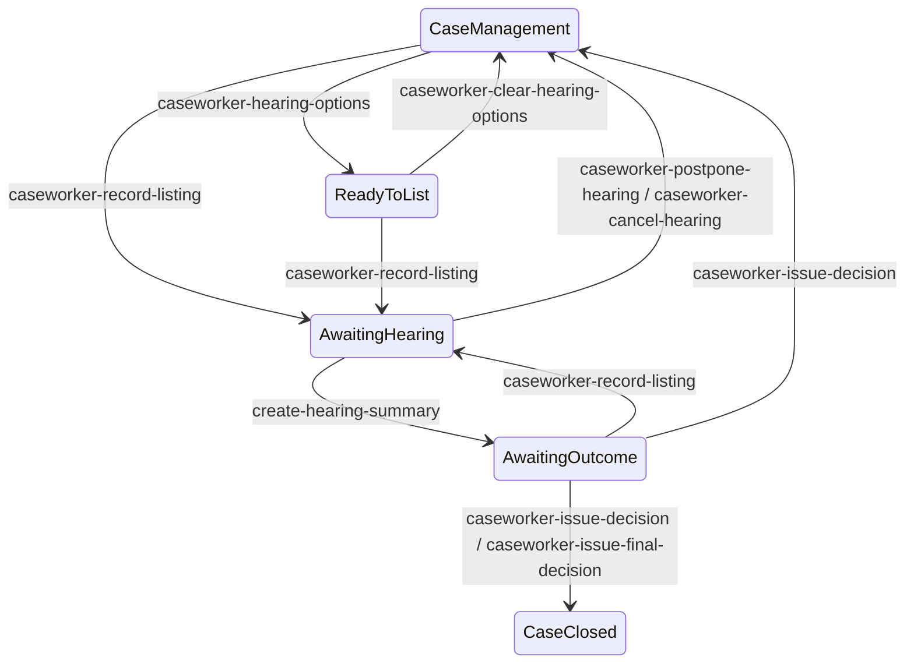

# Hearings and listing

This page describes how hearings are recorded for the `CriminalInjuriesCompensation` case type. In summary:

- A hearing is a set of CCD case fields on the CIC case. Caseworkers record and change them through ExUI events that this service handles.
- There is no HMC or List Assist integration in this service: no hearings client, no HMC config and no outbound listing call. Hearings exist only in CCD case data.
- Main events: `caseworker-record-listing` (CaseManagement, ReadyToList or AwaitingOutcome to AwaitingHearing), `caseworker-edit-record-listing` (stays in AwaitingHearing), `caseworker-postpone-hearing` and `caseworker-cancel-hearing` (both back to CaseManagement), and `create-hearing-summary` (AwaitingHearing to AwaitingOutcome) and `edit-hearing-summary`.
- Panel composition and hearing options have their own events: `caseworker-panel-composition`, `caseworker-edit-panel-composition`, `caseworker-hearing-options` (to ReadyToList) and `caseworker-clear-hearing-options` (ReadyToList to CaseManagement).
- Venues come from `rd-location-ref-api` through `LocationClient`. Judges for the hearing summary come from `rd-judicial-api` through `JudicialClient`.
- A cron (`SystemTriggerCompleteHearingOutcomeTask`) flags cases whose hearing is today, which raises a Work Allocation "Complete hearing outcome" task. A sibling cron triggers hearing-bundle stitching for hearings in the next 14 days. Both run in demo and AAT only.

## Where hearing data lives

There is no separate hearings store. All hearing data sits in the CCD case JSON.

- [`Listing`](../src/main/java/uk/gov/hmcts/sptribs/caseworker/model/Listing.java) holds a listing: `date`, `hearingTime`, `session`, region and venue, `hearingType`, `hearingFormat` (face to face, hybrid, video, telephone or paper), `hearingStatus`, postponement and cancellation details, and the nested `summary` ([`HearingSummary`](../src/main/java/uk/gov/hmcts/sptribs/caseworker/model/HearingSummary.java)).
- Hearings are held in the `hearingList` collection (`List<ListValue<Listing>>` on `CaseData`). The bundle-stitching task searches on `data.hearingList.value.date`.
- Older cases held one hearing in the single `listing` field. `SystemMigrateOldHearing` (`system-migrate-old-hearing`) calls [`HearingService`](../src/main/java/uk/gov/hmcts/sptribs/caseworker/service/HearingService.java)`.addListingIfExists`, which copies that listing into `hearingList` and carries over the retired postpone and cancel fields.
- The **Hearings** tab (`CaseTypeTab.buildHearing`, tab ID `hearings`, in [`CaseTypeTab`](../src/main/java/uk/gov/hmcts/sptribs/ciccase/tab/CaseTypeTab.java)) shows listing details, the hearing summary, the panel fields and the format to caseworkers.
- Hearing recordings, when uploaded, are documents of type `HEARING_RECORD` in the `case_document_types` lookup. See [documents and bundles](documents-and-bundles.md).

When a listing is created or changed, the service updates the case data in its `aboutToSubmit` callback and CCD persists it. Nothing is sent to HMC or any scheduling system.

The chosen venue is stored as text (court name and address, from `readOnlyHearingVenueName` and `hearingVenueNameAndAddress`). The venue drop-down uses generated UUIDs as codes, so no ePIMMS ID is kept in case data.

## Listing events

All of these are caseworker events in [`src/main/java/uk/gov/hmcts/sptribs/caseworker/event/`](../src/main/java/uk/gov/hmcts/sptribs/caseworker/event/). The listing, postpone and cancel events grant create, read and update to `SUPER_USER`, caseworker, senior caseworker, hearing-centre admin and team leader, senior judge and the WA config user. `ST_CIC_JUDGE` gets history only. The hearing-options events grant only the caseworker and hearing-centre roles.

| Event ID | Class | State change | What it does |
|---|---|---|---|
| `caseworker-record-listing` | `CaseworkerRecordListing` | CaseManagement, ReadyToList, AwaitingOutcome → AwaitingHearing | Shows region and venue pages in `aboutToStart`, adds the listing to `hearingList` in `aboutToSubmit`, and notifies parties in `submitted`. |
| `caseworker-edit-record-listing` | `CaseworkerEditRecordListing` | AwaitingHearing → AwaitingHearing (no move) | Edits a chosen listed hearing (`aboutToStart`, `aboutToSubmit`, `submitted`). |
| `caseworker-postpone-hearing` | `CaseworkerPostponeHearing` | AwaitingHearing → CaseManagement | Sets `hearingStatus` to `Postponed` and records the postpone date. |
| `caseworker-cancel-hearing` | `CaseworkerCancelHearing` | AwaitingHearing → CaseManagement | Sets `hearingStatus` to `Cancelled` and records the cancelled date. |
| `caseworker-hearing-options` | `CaseworkerHearingOptions` | CaseManagement, ReadyToList → ReadyToList | Captures region, venue, room, instructions, format and short notice before listing. |
| `caseworker-clear-hearing-options` | `CaseworkerClearHearingOptions` | ReadyToList → CaseManagement | Clears those hearing-option fields (in `aboutToSubmit`) and recalculates the first order due date. |

The Work Allocation DMNs match on the full event IDs from [`EventConstants`](../src/main/java/uk/gov/hmcts/sptribs/caseworker/util/EventConstants.java). The cancellation DMN cancels the `HearingCompletion` and `HearingBundle` task categories on `caseworker-postpone-hearing` and `caseworker-cancel-hearing`. It reconfigures tasks on `caseworker-record-listing`, `caseworker-edit-record-listing`, `caseworker-postpone-hearing`, `caseworker-cancel-hearing` and `create-hearing-summary`. See [work allocation](work-allocation.md).

A typical path looks like this. The [case lifecycle](case-lifecycle.md) page has the full state model.

GOV.UK Notify templates for hearing events are configured in `application.yaml` under `uk.gov.notify.email.templatesCIC`. Listing events notify parties by email or by letter, depending on each party's contact preference (for example `ListingCreatedNotification`). See [notifications](notifications.md).

## Hearing summaries and outcomes

| Event ID | Class | States | Callbacks | Notes |
|---|---|---|---|---|
| `create-hearing-summary` | `CaseWorkerCreateHearingSummary` | AwaitingHearing → AwaitingOutcome | `aboutToStart`, `aboutToSubmit`, `submitted` | Records what happened at the hearing. `aboutToStart` loads judges from JRD. `aboutToSubmit` sets `hearingStatus` to `Complete`, stores the judge's personal code as `judicialId`, saves the summary and uploads recordings as `HEARING_RECORD`. Caseworker, hearing-centre and senior-judge roles can run it. `ST_CIC_JUDGE` gets history only. |
| `edit-hearing-summary` | `CaseWorkerEditHearingSummary` | AwaitingOutcome, CaseClosed (no move) | `aboutToStart`, `aboutToSubmit`, `submitted` | Amends an existing summary and adds, recategorises or removes recordings. Judges get history only. |

`create-hearing-summary` always moves the case to `AwaitingOutcome`. The move out of `AwaitingOutcome` belongs to the decision events. `caseworker-issue-decision` moves the case to `CaseManagement`, or to `CaseClosed` for a Rule 27 or strike-out decision. `caseworker-issue-final-decision` moves it to `CaseClosed`. No event on master moves a case into `Completed`.

Decisions and final decisions are covered in [documents and bundles](documents-and-bundles.md).

## The complete-hearing-outcome cron

The "Complete hearing outcome" Work Allocation task is raised by a scheduled job.

- **Task:** [`SystemTriggerCompleteHearingOutcomeTask`](../src/main/java/uk/gov/hmcts/sptribs/systemupdate/schedule/wa/SystemTriggerCompleteHearingOutcomeTask.java). It runs as a one-shot Spring Boot process. The container starts with `TASK_NAME=SystemTriggerCompleteHearingOutcomeTask`, and [`ScheduledTaskRunner`](../src/main/java/uk/gov/hmcts/sptribs/systemupdate/service/ScheduledTaskRunner.java) finds the bean and calls `run()`.
- **Query:** cases with `state` = `AwaitingHearing`, `data.completeHearingOutcomeTask` not `Yes`, and a `data.hearingList.value.date` of today.
- **Event:** for each match it submits `system-trigger-complete-hearing-outcome` (`SystemTriggerCompleteHearingOutcome`) as the system-update user. The event is valid only in `AwaitingHearing`, is granted to `SYSTEM_UPDATE` (and `ST_CIC_WA_CONFIG_USER`), and is published to Camunda.
- **Effect:** `aboutToSubmit` only sets `completeHearingOutcomeTask=Yes`, so each case is picked up once. The state does not change. The WA initiation DMN maps this event in `AwaitingHearing` to the `completeHearingOutcome` task ("Complete hearing outcome").
- **Schedule:** the base HelmRelease (`sptribs-cron-trigger-complete-hearing-outcome`) in [`cnp-flux-config`](https://github.com/hmcts/cnp-flux-config) sets `0 8 * * 1-5`. The demo and AAT overlays override it to `0 8-17 * * 1-5`, hourly from 08:00 to 17:00, Monday to Friday. It uses the `sptribs-cron` chart and the `sptribs-case-api` image.
- **Environments:** only demo and AAT reference it. Prod, perftest and ithc do not run it, so in those environments the "Complete hearing outcome" task is not created this way.

A sibling task belongs to the same hearing flow. `SystemTriggerStitchCollateHearingBundleTask` runs on the same schedules and in the same environments. It searches for cases in `AwaitingHearing` with a hearing date from today to 14 days ahead (`data.hearingList.value.date`) that are not yet flagged `stitchHearingBundleTask=Yes`. It then submits `system-trigger-stitch-collate-hearing-bundle`. In both tasks, a failed submit for one case is logged and the loop moves on. A `CcdConflictException` is caught outside the loop, so it stops the whole run.

`SystemRemoveFirstHearingDateTask` is a one-off data migration. Its base CronJob is `suspend: true`, and only AAT references it. It is not deployed to prod. See [scheduled tasks](scheduled-tasks.md).

## Panel composition

Panel composition records the make-up of the tribunal panel, by role.

- `caseworker-panel-composition` (`CaseworkerPanelComposition`) and `caseworker-edit-panel-composition` (`CaseworkerEditPanelComposition`) are both available in CaseManagement, ReadyToList and AwaitingHearing. Both are granted to the caseworker, hearing-centre, judge and senior-judge roles.
- The first is shown only while `panel1` is not yet "Tribunal Judge". Its `aboutToStart` sets `panel1` to "Tribunal Judge". The edit event is shown only once `panel1` is set.
- Fields, all on `listing.summary` (`HearingSummary`):
  - `panel1`: read-only text, always "Tribunal Judge".
  - `panel2`: optional fixed list `SecondPanelMember` (Tribunal Judge, Medical Member or Lay Member).
  - `panel3`: optional fixed list `ThirdPanelMember` (Medical Member or Lay Member).
  - `panelMemberInformation`: optional text area, "Specialisms or reserved panel member information".
  - `panelComposition`: derived fixed list `PanelComposition` (Panel 1, 2 or 3).
- `aboutToSubmit` does no validation. It calls `HearingSummary.populatePanelComposition()`. Both `panel2` and `panel3` set gives Panel 3, one of them gives Panel 2, and neither gives Panel 1.
- Panel composition stores roles, not people. Named judicial users are chosen in `create-hearing-summary`, where `judge` and `memberList` are filled from JRD.
- The panel fields show on the Hearings tab.

## Venue and judge lookups

Both lookups are Feign clients that send an S2S token (`sptribs_case_api`).

| Lookup | Client | RD service | Methods | Config |
|---|---|---|---|---|
| Hearing venues | [`LocationClient`](../src/main/java/uk/gov/hmcts/sptribs/recordlisting/LocationClient.java), wrapped by `LocationService` | [`rd-location-ref-api`](https://github.com/hmcts/rd-location-ref-api): GET `/refdata/location/court-venues` and GET `/refdata/location/regions` | `getHearingVenues(serviceAuth, auth, regionId, isHearingLocation)`, `getRegions(serviceAuth, auth, regionId)` | `location.api.baseUrl` from `LOCATION_API_URL` |
| Judicial users | [`JudicialClient`](../src/main/java/uk/gov/hmcts/sptribs/judicialrefdata/JudicialClient.java), wrapped by [`JudicialService`](../src/main/java/uk/gov/hmcts/sptribs/judicialrefdata/JudicialService.java) | [`rd-judicial-api`](https://github.com/hmcts/rd-judicial-api): POST `/refdata/judicial/users` | `getUserProfiles(serviceAuth, auth, pageSize, accept, judicialUsersRequest)` | `judicial.api.baseUrl` from `JUDICIAL_API_URL`. `JUDICIAL_USERS_PAGE_SIZE`, default 200 |

- Venue calls pass the caseworker's own token. The regions list leaves out "Northern Ireland" and "National". Venues are requested with `isHearingLocation=Y`, then filtered by service code `BBA2`, or by court type ID when RD returns no service code.
- Judicial calls use the system-update user's token, and the request filters on `ccdServiceName` = `ST_CIC`. Results come back as `UserProfileRefreshResponse` records and feed the judge and panel-member drop-downs in the hearing summary.
- `JudicialService` makes one call with the configured page size and does not request further pages. The drop-down holds at most `JUDICIAL_USERS_PAGE_SIZE` users.
- `sptribs_case_api` must be in each RD service's S2S authorised list.

## Bank holidays

Bank holidays do not drive hearing scheduling. They are used once: `caseworker-issue-case` uses them to move the respondent bundle due date (`respondentBundleDueDate`) off a weekend or bank holiday.

- `BankHolidaysApi.retrieveAll()` makes one GET to the configured URL and returns `BankHolidayResponse` (one `division` and its `events`, each with date and title).
- [`BankHolidayService`](../src/main/java/uk/gov/hmcts/sptribs/bankholidays/service/BankHolidayService.java)`.getScottishBankHolidays(uri)` wraps it. The result is cached in `scottish_bank_holiday_cache` (Caffeine, `expireAfterWrite` 180 days, maximum one entry). A changed holiday list is picked up when the entry expires or the pod restarts.
- The URL in `application.yaml` (`bank-holidays.api.url`) is `https://www.gov.uk/bank-holidays/scotland.json`, with no environment override. That feed returns only the Scotland division, so only Scottish bank holidays are treated as non-working days.

## See also

- [Case lifecycle](case-lifecycle.md): the full state model around AwaitingHearing and AwaitingOutcome
- [Events reference](events-reference.md): every event ID, with states and roles
- [Scheduled tasks](scheduled-tasks.md): all `TASK_NAME` jobs and their CronJob schedules
- [Documents and bundles](documents-and-bundles.md): hearing bundles, decisions and orders
- [Work allocation](work-allocation.md): how hearing events create and close tasks
