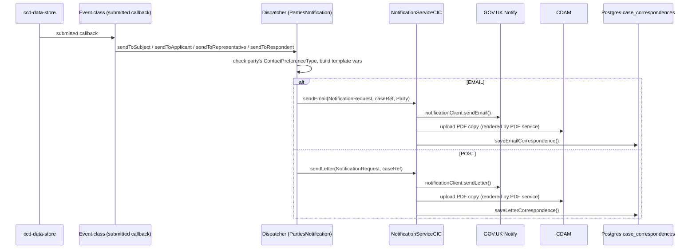

# Notifications and correspondence

This service sends case notifications for the `CriminalInjuriesCompensation` case type through GOV.UK Notify, using the `uk.gov.service.notify` Java client (`NotificationClient`). Notify sends both emails and letters. Every notification sent is recorded in the service's own Postgres table, `case_correspondences`, with a PDF copy stored in CDAM. This page explains the configuration, the dispatcher pattern, which events notify whom, and how correspondence is recorded. For the recipe, see [adding-a-notification.md](adding-a-notification.md).

In summary:

- Each kind of notification has its own dispatcher class. There are 19 under [`notification/dispatcher/`](../src/main/java/uk/gov/hmcts/sptribs/notification/dispatcher/), plus `DssApplicationReceivedNotification` under `citizen/event/`. Dispatchers implement `PartiesNotification` and have one `sendTo*` method per party.
- Each party's contact preference (`ContactPreferenceType.EMAIL` or `POST`) picks the channel. An email goes through `NotificationServiceCIC.sendEmail()` and a letter through `NotificationServiceCIC.sendLetter()`.
- Template IDs are held in `application.yaml`, keyed by `TemplateName`. Variant suffixes: `_CY` for Welsh and `_NEW_CD` for the version used when the citizen dashboard feature flag is on.
- Welsh is used for one notification: the application-received email after a citizen submits a DSS application in Welsh.
- If a notification fails, the event's submitted callback catches the error and shows a "notification failed, please resend" confirmation. There is no retry and no fallback from email to post.

## Configuration

GOV.UK Notify settings live in [`application.yaml`](../src/main/resources/application.yaml):

| Setting | Value / source |
|---|---|
| API key | `uk.gov.notify.api.sptribskey`, set to `${UK_GOV_NOTIFY_API_KEY_1:dummy}`. Deployed from the `sptribs` Key Vault secret `uk-gov-notify-api-key` (aliased to `UK_GOV_NOTIFY_API_KEY_1` in [`values.yaml`](../charts/sptribs-case-api/values.yaml)) |
| Base URL | `uk.gov.notify.api.baseUrl`: `https://api.notifications.service.gov.uk` |
| Shared template variables | `signInProfessionalUsersUrl`, plus the respondent's and tribunal's name, organisation and email |
| Citizen dashboard link | `sptribs-frontend.dashboard-url`. Only added to template variables when `feature.citizen-dashboard.enabled` is true (env `CITIZEN_DASHBOARD_ENABLED`, default `false`) |
| CIC template IDs | `uk.gov.notify.email.templatesCIC`: a map of template name to Notify template ID, about 50 entries covering email, post and Welsh variants |

[`NotificationsConfiguration`](../src/main/java/uk/gov/hmcts/sptribs/common/config/NotificationsConfiguration.java) builds the `NotificationClient` bean from `${uk.gov.notify.api.sptribskey}` and `${uk.gov.notify.api.baseUrl}`.

The [`TemplateName`](../src/main/java/uk/gov/hmcts/sptribs/notification/TemplateName.java) enum names every template, and the YAML map is keyed by the same names. Template families include `APPLICATION_RECEIVED`, `CASE_ISSUED`, the hearing events (`HEARING_CREATED`, `HEARING_UPDATED`, `HEARING_POSTPONED`, `HEARING_CANCELLED`), `DECISION_ISSUED`, `FINAL_DECISION_ISSUED`, `BUNDLE_CREATED`, `CASE_STAYED` / `CASE_UNSTAYED`, `CASE_LINKED` / `CASE_UNLINKED`, `CASE_WITHDRAWN`, `REINSTATED`, `UPDATE_RECEIVED`, `CONTACT_PARTIES`, `ANONYMITY_APPLIED` and `NEW_ORDER_ISSUED`. Names can carry suffixes:

| Suffix | Meaning | Example |
|---|---|---|
| *(none)* or `_EMAIL` | English email | `APPLICATION_RECEIVED`, `DECISION_ISSUED_EMAIL` |
| `_POST` | Letter template | `CASE_ISSUED_CITIZEN_POST`, `CASE_LINKED_POST` |
| `_NEW_CD` | Version with a link to the citizen dashboard. Chosen instead of the plain template when `feature.citizen-dashboard.enabled` is true | `APPLICATION_RECEIVED_NEW_CD` |
| `_CY` | Welsh version | `APPLICATION_RECEIVED_CY`, `DECISION_ISSUED_EMAIL_NEW_CD_CY` |

The template IDs are literal strings. Nothing checks them against Notify at start-up, so a wrong ID only shows up when a send fails at runtime. `GetAllTemplatesFromNotify` is a standalone utility for listing templates, not a start-up check.

## The dispatcher pattern

1. An event's `submitted` callback calls the right dispatcher, after CCD has saved the case. The callbacks are methods on the event config classes, registered with `.submittedCallback(this::submitted)`. There are no separate callback controllers for notifications. For example, `CaseworkerContactParties` and `CaseworkerSendOrder` send their correspondence there.
2. The event decides which parties to notify, usually from the caseworker's selections (`notifyPartySubject`, `notifyPartyApplicant` and so on). The dispatcher then picks the channel for each party. The subject uses the case's `contactPreferenceType`, the applicant uses `applicantContactDetailsPreference`, and the representative uses `representativeContactDetailsPreference`. The respondent and tribunal are always emailed. Check the dispatcher you are working on for the exact field it reads for each party.
3. [`NotificationHelper`](../src/main/java/uk/gov/hmcts/sptribs/notification/NotificationHelper.java) builds the template variable map. For post, `addAddressTemplateVars` copies address lines 1 to 3, post town, county, country and postcode into `address_line_1` to `address_line_7`.
4. The dispatcher picks a `TemplateName` and calls [`NotificationServiceCIC`](../src/main/java/uk/gov/hmcts/sptribs/notification/NotificationServiceCIC.java).

Channel rules:

- Most dispatchers send an email when the preference is `EMAIL` and a letter otherwise, so a party with no preference set gets a letter. The email address is not checked first, and there is no fallback from email to post.
- `ApplicationReceivedNotification`, `DssApplicationReceivedNotification`, `BundleCreatedNotification`, `AnonymityAppliedNotification` and `DssUpdateCaseSubmissionNotification` only send email. A party whose preference is not `EMAIL` gets nothing from them.

## Which events notify whom

Event IDs are from [`EventConstants.java`](../src/main/java/uk/gov/hmcts/sptribs/caseworker/util/EventConstants.java) and `caseinfo.apps` in `application.yaml`. See [events-reference.md](events-reference.md) for the full event list.

| Dispatcher | CCD event (class) | Recipients | Channels | Templates |
|---|---|---|---|---|
| `ApplicationReceivedNotification` | `caseworker-create-case` (`CreateCase`) | Subject, applicant, representative | Email only | `APPLICATION_RECEIVED`, `APPLICATION_RECEIVED_NEW_CD` |
| `DssApplicationReceivedNotification` (in `citizen/event/`) | `citizen-cic-submit-dss-application` (`CicSubmitCaseEvent`) | Subject, representative (where an email was given) | Email only | `APPLICATION_RECEIVED`, `APPLICATION_RECEIVED_NEW_CD`, `APPLICATION_RECEIVED_CY`, `APPLICATION_RECEIVED_NEW_CD_CY` |
| `CaseIssuedNotification` | `caseworker-issue-case` (`CaseworkerIssueCase`) | Subject, applicant, representative, respondent | Email or post | `CASE_ISSUED_CITIZEN_EMAIL`, `CASE_ISSUED_CITIZEN_POST`, `CASE_ISSUED_RESPONDENT_EMAIL` |
| `ListingCreatedNotification` | `caseworker-record-listing` (`CaseworkerRecordListing`) | Subject, applicant, representative, respondent | Email or post | `HEARING_CREATED_EMAIL`, `HEARING_CREATED_POST` |
| `ListingUpdatedNotification` | `caseworker-edit-record-listing` (`CaseworkerEditRecordListing`) | Subject, representative, respondent | Email or post | `HEARING_UPDATED_EMAIL`, `HEARING_UPDATED_POST` |
| `HearingPostponedNotification` | `caseworker-postpone-hearing` (`CaseworkerPostponeHearing`) | Subject, representative, respondent | Email or post | `HEARING_POSTPONED_EMAIL`, `HEARING_POSTPONED_POST` |
| `CancelHearingNotification` | `caseworker-cancel-hearing` (`CaseworkerCancelHearing`) | Subject, applicant, representative, respondent | Email or post | `HEARING_CANCELLED_EMAIL`, `HEARING_CANCELLED_POST` |
| `BundleCreatedNotification` | `createBundle` (`CaseworkerCreateBundle`), not when the case is closed | Subject, applicant, representative, respondent | Email only | `BUNDLE_CREATED_EMAIL_CITIZEN`, `BUNDLE_CREATED_EMAIL_RESPONDENT` |
| `DecisionIssuedNotification` | `caseworker-issue-decision` (`CaseworkerIssueDecision`) | Subject, applicant, representative, respondent | Email or post | `DECISION_ISSUED_EMAIL`, `DECISION_ISSUED_EMAIL_NEW_CD`, `DECISION_ISSUED_POST` |
| `CaseFinalDecisionIssuedNotification` | `caseworker-issue-final-decision` (`CaseworkerIssueFinalDecision`) | Subject, applicant, representative, respondent | Email or post | `FINAL_DECISION_ISSUED_EMAIL`, `FINAL_DECISION_ISSUED_EMAIL_NEW_CD`, `FINAL_DECISION_ISSUED_POST` |
| `NewOrderIssuedNotification` | `caseworker-send-order` (`CaseworkerSendOrder`) and `create-and-send-order` (`CaseworkerCreateAndSendOrder`) | Subject, applicant, representative, respondent | Email or post | `NEW_ORDER_ISSUED_EMAIL`, `NEW_ORDER_ISSUED_EMAIL_NEW_CD`, `NEW_ORDER_ISSUED_POST` |
| `AnonymityAppliedNotification` | `caseworker-update-anonymity`, `createFlags` (`CaseworkerCaseFlag`) and `create-and-send-order`, only when anonymity is newly applied | Tribunal | Email only | `ANONYMITY_APPLIED_EMAIL` |
| `ContactPartiesNotification` | `contact-parties` (`CaseworkerContactParties`) and `respondent-contact-parties` (`RespondentContactParties`) | Parties selected: subject, applicant, representative, plus respondent (caseworker event) or tribunal (respondent event) | Email or post | `CONTACT_PARTIES_EMAIL`, `CONTACT_PARTIES_EMAIL_NEW_CD`, `CONTACT_PARTIES_POST` |
| `CaseStayedNotification` | `caseworker-stay-the-case` (`CaseworkerStayTheCase`) | Subject, applicant, representative | Email or post | `CASE_STAYED_EMAIL`, `CASE_STAYED_POST` |
| `CaseUnstayedNotification` | `caseworker-remove-stay` (`CaseworkerRemoveStay`) | Subject, applicant, representative | Email or post | `CASE_UNSTAYED_EMAIL`, `CASE_UNSTAYED_POST` |
| `CaseLinkedNotification` | `createCaseLink` (`CaseworkerLinkCase`) | Subject, applicant, representative | Email or post | `CASE_LINKED_EMAIL`, `CASE_LINKED_POST` |
| `CaseUnlinkedNotification` | `maintainCaseLink` (`CaseworkerMaintainLinkCase`) | Subject, applicant, representative | Email or post | `CASE_UNLINKED_EMAIL`, `CASE_UNLINKED_POST` |
| `CaseWithdrawnNotification` | `caseworker-close-the-case` (`CaseworkerCloseTheCase`) | Subject, applicant, representative, respondent | Email or post | `CASE_WITHDRAWN_EMAIL`, `CASE_WITHDRAWN_POST` |
| `CaseReinstatedNotification` | `caseworker-reinstate-state` (`ReinstateCase`) | Subject, applicant, representative, respondent | Email or post | `REINSTATED_EMAIL`, `REINSTATED_POST` |
| `DssUpdateCaseSubmissionNotification` | `citizen-cic-dss-update-case` (`CicDssUpdateCaseEvent`) | Applicant, tribunal | Email only | `UPDATE_RECEIVED`, `UPDATE_RECEIVED_CIC` |

## How post is sent

`NotificationServiceCIC.sendLetter()` calls `notificationClient.sendLetter()` on the GOV.UK Notify Java client and gets back a `SendLetterResponse` with a Notify notification ID. The letter template is a Notify template, and the address lines are passed as template variables. Notify prints and posts the letter. This service only knows that Notify accepted the request. If no address line is filled in, the send throws before the correspondence row is saved.

Letters do not go through the HMCTS send-letter-service. `application.yaml` (`send-letter.url`) and the Helm chart set a send-letter service URL (`SEND_LETTER_SERVICE_BASEURL`), but no Java code on master reads it.

## The correspondence table

Postgres is a supporting store. Case data stays in CCD. See [data-and-persistence.md](data-and-persistence.md) for the wider picture.

Flyway migration [`V1__create_correspondence_table.sql`](../src/main/resources/db/migration/) creates `case_correspondences`, which `CorrespondenceRepository` (JPA, `CorrespondenceEntity`) reads and writes. Later migrations change it. `V1.5__alter_case_correspondences.sql` adds a unique constraint on `id`, creates the `party` enum type and adds the `receiving_party` column. `V1.6__create_correspondence_document_table.sql` adds a `correspondence_document` table joining correspondence to `case_documents`.

| Column | Content |
|---|---|
| `id` | Notify notification ID |
| `event_type` | Template name, for example `APPLICATION_RECEIVED` |
| `case_reference_number` | CIC case reference, long form without hyphens |
| `sent_on` | `OffsetDateTime` |
| `sent_from` | Notify's from-address for emails if returned, otherwise "Criminal Injuries Compensation Tribunal" |
| `sent_to` | Email address, or the postal address joined with commas |
| `correspondence_type` | `Email` or `Letter` |
| `receiving_party` | `Party` enum value. Only `ContactPartiesNotification` and `CaseFinalDecisionIssuedNotification` pass a party. Other dispatchers and all letters leave it null |
| `document_url`, `document_binary_url`, `document_filename` | CDAM copy of the correspondence PDF |

After Notify accepts a message, `saveEmailCorrespondence()` or `saveLetterCorrespondence()` calls `getPDF()`. That renders the Notify response body and subject into `templates/sent_notification.html` through the PDF service client, uploads the PDF to CDAM as `RESTRICTED` for `CriminalInjuriesCompensation` / `ST_CIC`, and stores the URLs on the row. Letters and emails are treated the same way. See [documents-and-bundles.md](documents-and-bundles.md) for CDAM.

The case's **Correspondence** tab (`buildCorrespondenceTab` in `CaseTypeTab`) shows the `correspondence` field. That field is marked `@External` on `CaseData` and is not stored in the CCD case JSON. `CicCaseView` fills it on every case load from `correspondenceRepository.findAllByCaseReferenceNumberOrderBySentOnDesc()`, newest first. So the tab reads Postgres.

## Welsh

Welsh templates exist as `_CY` entries in `TemplateName` and in the template-ID map: `APPLICATION_RECEIVED_CY`, `APPLICATION_RECEIVED_NEW_CD_CY`, `BUNDLE_CREATED_EMAIL_CITIZEN_CY`, `DECISION_ISSUED_EMAIL_NEW_CD_CY`, `CONTACT_PARTIES_EMAIL_NEW_CD_CY`, `FINAL_DECISION_ISSUED_EMAIL_NEW_CD_CY` and `NEW_ORDER_ISSUED_EMAIL_NEW_CD_CY`.

One dispatcher selects a Welsh template. [sptribs-frontend](https://github.com/hmcts/sptribs-frontend) sets `dssCaseDataLanguagePreference` to `WELSH` when the citizen's session language is `cy` at DSS submission. `DssApplicationReceivedNotification` reads `DssCaseData.languagePreference` and picks `APPLICATION_RECEIVED_CY` or `APPLICATION_RECEIVED_NEW_CD_CY` for the subject and representative emails.

No other dispatcher reads `LanguagePreference`, so other notifications are sent in English.

Generated documents (Docmosis orders and decisions) are separate from Notify. `docmosis.templates` in `application.yaml` only has an `english` map, and the callers pass `LanguagePreference.ENGLISH`.

## Failure behaviour

- `NotificationServiceCIC` logs the error and rethrows it as `NotificationException`. The event's `submitted` method catches it, so the CCD event still completes, and returns a confirmation header telling the caseworker the notification failed and should be resent.
- Most events call their dispatchers one after another inside a single `try`, so a failure for one party stops the parties after it. `CaseworkerIssueCase` wraps each party separately, and `BundleCreatedNotification.dispatch()` reports failed parties individually.
- There is no retry. A send that Notify rejects leaves no `case_correspondences` row.
- The PDF copy is made after Notify has accepted the message. If the PDF render or CDAM upload fails, the message has already gone but no row is saved and the event reports a failure, so a resend sends it again.
- Reading a correspondence PDF needs CDAM authentication.

## See also

- [Adding a notification](adding-a-notification.md): the step-by-step recipe
- [Documents and bundles](documents-and-bundles.md): documents, CDAM and generated orders
- [Case lifecycle](case-lifecycle.md): the events that trigger notifications
- [Configuration](configuration.md): secrets for GOV.UK Notify access
