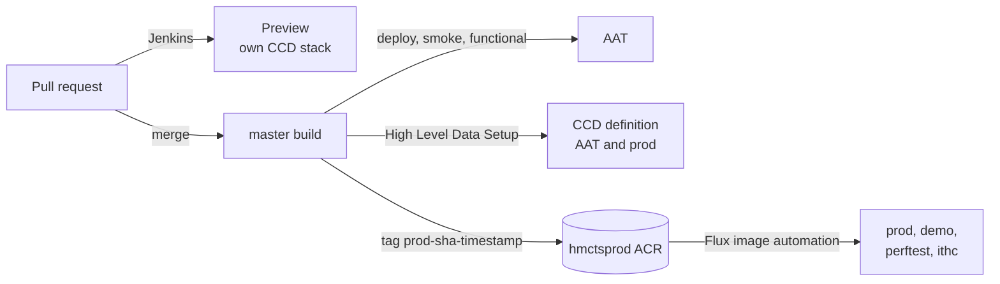

# Release and deploy

This page explains how a change to `sptribs-case-api` reaches each environment. The service ships through the standard CNP Jenkins pipeline in [`Jenkinsfile_CNP`](../Jenkinsfile_CNP). A PR deploys to preview. A merge to master deploys to AAT, imports the CCD definition into AAT and prod, and publishes a `prod-` image tag. Flux image automation in [cnp-flux-config](https://github.com/hmcts/cnp-flux-config) then rolls that image out to prod, demo, perftest and ITHC. There is no manual approval step.



## Environments

| Environment | Purpose | case-api host | How it is deployed |
|---|---|---|---|
| preview | One release per PR | `sptribs-case-api-pr-<PR>.preview.platform.hmcts.net`, with XUI at `https://xui-sptribs-case-api-pr-<PR>.preview.platform.hmcts.net` | Jenkins, per PR |
| aat | Target of every master build. Smoke, functional and nightly tests run here | `sptribs-case-api-aat.service.core-compute-aat.internal` | Jenkins deploy, then Flux |
| demo | Demonstrations and WA rule changes | `sptribs-case-api-demo.service.core-compute-demo.internal` | Flux |
| ithc | IT health check | `sptribs-case-api-ithc.service.core-compute-ithc.internal` | Flux |
| perftest | Performance testing | `sptribs-case-api-perftest.service.core-compute-perftest.internal` | Flux |
| prod | Live service | `sptribs-case-api-prod.service.core-compute-prod.internal` | Flux |

The API is internal only. Everything runs in the `sptribs` namespace. Each Flux environment has two AKS clusters, `00` and `01`, which build on a shared `apps/sptribs/<env>/base` overlay.

Service Bus publishing (`SPRING_JMS_SERVICEBUS_ENABLED`, `SPTRIBS_SERVICEBUS_SCHEDULER_ENABLED`) is on in every Flux environment, either explicitly or through the application default. It is off in preview unless the `pr-values:wa` label is set. See [Work Allocation](work-allocation.md).

## 1. Raise the PR and use preview

1. Open the PR against master. GitHub Actions [`ci.yml`](../.github/workflows/ci.yml) runs `check` and `integration` on Java 21. Jenkins runs `Jenkinsfile_CNP` alongside it.
2. The pipeline is `type = "java"`, product `sptribs`, component `case-api`. It reads secrets from the `s2s-${env}`, `ccd-${env}` and `sptribs-${env}` Key Vaults.
3. A preview release deploys a CCD stack with the app: the CCD data and definition stores, the API gateway and Elasticsearch. The app uses the database `pr-${CHANGE_ID}-sptribs-case-api` and the data store uses `pr-${CHANGE_ID}-data-store`, both on the preview Postgres server. Flyway runs on start-up. Service Bus is off. These settings are in [`values.preview.template.yaml`](../charts/sptribs-case-api/values.preview.template.yaml).
4. The pipeline's High Level Data Setup stage imports the generated definition into the PR's definition store (see [section 4](#4-ccd-definition-import)).
5. Add labels as needed:

| Label | Effect |
|---|---|
| `enable_keep_helm` | Keeps the preview Helm release after the pipeline finishes, so you can test it by hand |
| `pr-values:wa` | Deploys with [`values.wa.preview.template.yaml`](../charts/sptribs-case-api/values.wa.preview.template.yaml), which adds the Work Allocation pods and turns on Service Bus |
| `pr-values:wa-ft-tests` | Runs the WA functional tests. Needs `pr-values:wa` as well |
| `enable-e2e-tests` | Runs the `sptribs-e2etests` job against the PR's XUI before the preview functional tests. A failure fails the build |
| `enable_ccd_diff` | Runs [`ccd-diff.yml`](../.github/workflows/ccd-diff.yml), which posts a CCD definition diff against master as a PR comment |

To test the citizen apps against a case-api PR, point them at `http://sptribs-case-api-pr-<PR>.preview.platform.hmcts.net`.

## 2. Merge to master and deploy to AAT

The master build runs these stages from the shared CNP library, in order:

1. Checkout, then Build.
2. Static checks and container build: unit tests, Sonar, security checks and the Docker build in parallel.
3. Promote Docker image, which tags the image `staging-<sha>-<timestamp>`. Pact consumer verification follows.
4. High Level Data Setup for AAT, which imports the CCD definition into AAT.
5. AKS deploy to AAT, Pact checks, smoke tests and functional tests against AAT. The DMN and BPMN files are uploaded to AAT before the functional tests and to prod straight after they pass.
6. Publish the Helm chart.
7. High Level Data Setup for prod, which imports the prod CCD definition.
8. Prod build promotion, which re-tags the image `prod-<sha>-<timestamp>`.
9. Sync branches with master: `syncBranchesWithMaster` pushes master to `demo`, `perftest` and `ithc`.

A failed stage stops the build. A red AAT smoke or functional test therefore stops the prod definition import and the `prod-` tag.

Images are published to `hmctsprod.azurecr.io/sptribs/case-api`.

## 3. How Flux promotes the image

Each HelmRelease `image:` line in cnp-flux-config carries an `{"$imagepolicy": "flux-system:<policy>"}` marker. Flux image automation rewrites that line to the newest image the policy selects and commits the change.

| Environment | case-api image policy |
|---|---|
| prod, aat | `sptribs-case-api` (marker on the base HelmRelease) |
| demo | `demo-sptribs-case-api` (`apps/sptribs/sptribs-case-api/demo.yaml`) |
| perftest | `perftest-sptribs-case-api` |
| ithc | `ithc-sptribs-case-api` |
| preview | None. Jenkins deploys each PR |

Every policy that a HelmRelease uses selects `prod-<sha>-<timestamp>` tags, newest timestamp first. Policies with no filter of their own inherit the default `^prod-[a-f0-9]+-(?P<ts>[0-9]+)` filter from `apps/flux-system/automation/prod-image-policy.yaml`. So once a master build passes AAT and publishes its `prod-` tag, every Flux environment moves to it. Builds of the `demo`, `perftest` and `ithc` branches don't change which image those environments run.

The cron HelmReleases (`sptribs-cron-*`) run the same image with a `TASK_NAME`, and their `job.image` lines carry the same marker, so they move with the app. `sptribs-cron-remove-first-hearing-date` uses its own policy on the same repository and default filter. See [Scheduled tasks](scheduled-tasks.md) for which crons run where.

## 4. CCD definition import

Definitions are generated from code, never written by hand. `generateCCDConfig` writes JSON to `build/definitions/`. [`bin/ccd-build-definition.sh`](../bin/ccd-build-definition.sh) then:

- runs `az acr login --name hmctsprod` to pull the definition-processor image;
- runs `generate-ccd-definition.sh` for each case-type directory under `build/definitions/`;
- excludes `*-nonprod.json` and `*-testing.json` when packaging;
- writes `build/ccd-config/ccd-<CaseType>-${CCD_DEF_NAME:-dev}.xlsx`.

### In the pipeline

`Jenkinsfile_CNP` calls `enableHighLevelDataSetup()`, which adds a High Level Data Setup stage per environment:

- A `before('highleveldatasetup')` hook runs `generateCCDConfig --rerun-tasks` and `bin/ccd-build-definition.sh`, then archives `build/ccd-config/*.xlsx`.
- The stage runs the Gradle `highLevelDataSetup` task, which runs [`HighLevelDataSetupApp`](../src/main/java/uk/gov/hmcts/sptribs/common/ccd/HighLevelDataSetupApp.java). It adds the CCD roles the service needs, then imports `ccd-CriminalInjuriesCompensation-<env>.xlsx` into the definition store. A 504 from the definition store is tolerated, because large imports finish after the gateway times out.

The stage runs for preview on every PR, for AAT and prod on master (prod after the AAT functional tests pass), and for demo, perftest and ithc on builds of those branches. It reads the `ccd-importer-username` and `ccd-importer-password` secrets.

### Manually

To build a definition for one environment, for example to repair it:

```bash
az login
./bin/generate-env-ccd-definition.sh aat   # or demo
```

The script sources `bin/local-ccd-config-env/target-env.<env>`, which sets `ENVIRONMENT`, `CASE_API_URL` and `CCD_DEF_NAME`. Only `aat` and `demo` have files. For any other environment, export those variables yourself first. Upload the XLSX through that environment's CCD definition import, then check it in ExUI by opening a `CriminalInjuriesCompensation` case.

## 5. DMN and BPMN deployment

`Jenkinsfile_CNP` calls `uploadDmnDiagrams()` and `uploadBpmnDiagram()` to push the Work Allocation files to each environment's Camunda:

| Environment | When |
|---|---|
| AAT | Before the AAT functional tests, on master |
| prod | After the AAT functional tests pass, on master |
| preview | After the chart installs, on PRs with the `pr-values:wa` label, followed by `setupRoleAssignments()` |
| demo, perftest, ithc | After checkout, on builds of those branches |

`uploadDmnDiagrams()` runs [`bin/wa/import-dmn-diagram.sh`](../bin/wa/import-dmn-diagram.sh) with tenant and product `st_cic`, posting every file in [`src/main/resources/dmn/`](../src/main/resources/dmn) with `deploy-changed-only=true`. `uploadBpmnDiagram()` runs `pull-latest-camunda-wa-files.sh master` and then `import-wa-bpmn-diagram.sh`. The scripts log a non-200 response and continue, so after a release that changes WA rules, check the console log for `upload failed with http code`.

Scripts for manual uploads are in [`bin/wa/`](../bin/wa):

- `import-dmn-diagram.sh` and `import-wa-bpmn-diagram.sh` import files into Camunda;
- `deploy-demo-dmn.sh` deploys local DMN files to demo;
- `pull-latest-camunda-wa-files.sh` fetches the latest Camunda definitions;
- `setup-role-assignments.sh` sets up WA role assignments.

## 6. Nightly pipelines

| Pipeline | Schedule | What it does |
|---|---|---|
| [`Jenkinsfile_nightly`](../Jenkinsfile_nightly) in this repository | `H 8 * * 1-5` | Checkout, build, dependency check and Fortify scan, with the Fortify reports archived. Notifies `#special-tribunals-builds` |
| `sptribs-e2etests` nightly | `H 8 * * 1-5` | Playwright end-to-end tests across DSS submit, DSS update and Case API in Chrome, Firefox and WebKit, plus accessibility tests, against AAT |

The `sptribs-e2etests` nightly is the main regression signal across the three applications. Check it is green before relying on a release. See [Testing](testing.md).

## 7. Infrastructure and Helm values

Azure resources are managed in [sptribs-shared-infrastructure](https://github.com/hmcts/sptribs-shared-infrastructure) (Terraform), not in this repository. It owns the `sptribs-<env>` Key Vault and the secrets it copies from other vaults, App Insights (`sptribs-appinsights`), the action group and exception alert, the Postgres flexible server, and the `sptribs-sendonly` rule on CCD's `ccd-case-events-<env>` topic. A PR there plans AAT and prod. A merge to master applies AAT, then prod, then syncs the other branches.

Application Helm values, such as environment variables and Key Vault secret names, are set in [`charts/sptribs-case-api/`](../charts/sptribs-case-api) and in the per-environment patches in cnp-flux-config, for example `apps/sptribs/sptribs-case-api/demo.yaml`. See [Configuration](configuration.md).

## Pre-release checklist

- [ ] The PR is green in GitHub Actions (`check`, `integration`) and Jenkins (preview deploy and smoke).
- [ ] For CCD changes, `enable_ccd_diff` was applied and the diff reviewed.
- [ ] For WA changes, the PR ran with `pr-values:wa` and `pr-values:wa-ft-tests`.
- [ ] New Flyway migrations are additive. `flyway.out-of-order` is `true`, so check the version ordering. See [Data and persistence](data-and-persistence.md).
- [ ] Every new Key Vault secret the chart references exists in `sptribs-<env>` for every environment, ITHC included. Add missing ones through sptribs-shared-infrastructure first.
- [ ] If other services must accept calls from this service, their S2S allow-lists include `sptribs_case_api`.
- [ ] After the merge, the High Level Data Setup stages passed for AAT and prod, and, where WA rules changed, the console log shows no `upload failed` lines.
- [ ] Flux has committed the new `prod-` tag and the prod HelmRelease has reconciled.
- [ ] Any new or changed cron job is listed in the target environment's kustomization in cnp-flux-config.

## Verify

1. Check the release is healthy in AAT (VPN required):

   ```bash
   curl -s http://sptribs-case-api-aat.service.core-compute-aat.internal/health
   ```

2. Check that Flux picked up the image. In cnp-flux-config, look for the image-automation commit that touches `apps/sptribs/sptribs-case-api/sptribs-case-api.yaml`. With cluster access:

   ```bash
   kubectl -n sptribs get helmrelease sptribs-case-api -o jsonpath='{.spec.values.java.image}'
   ```

   The tag should be `prod-<7-char sha>-<timestamp>` for your merge commit. Cron HelmReleases keep their image under `.spec.values.job.image`.

## See also

- [Testing](testing.md)
- [Scheduled tasks](scheduled-tasks.md)
- [Support runbook](support-runbook.md)
