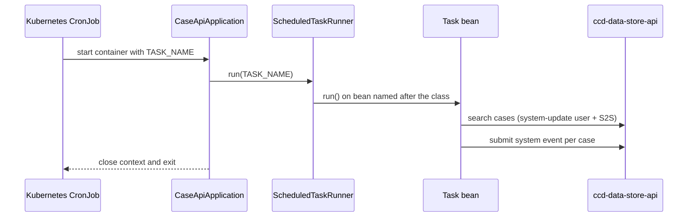

# Scheduled tasks and system events

This page explains how to run, schedule, suspend and retire a scheduled task or data migration, then lists every task and system event in the service. In summary:

- A scheduled task is a `Runnable` Spring bean. Setting the `TASK_NAME` environment variable makes the app run that one bean and then exit, instead of serving HTTP. [`ScheduledTaskRunner`](../src/main/java/uk/gov/hmcts/sptribs/systemupdate/service/ScheduledTaskRunner.java) does the lookup.
- To run one locally, use `TASK_NAME=SystemClearInactiveDssDraftCasesTask ./gradlew bootRun`, or `java -jar build/libs/sptribs-case-api.jar` with the same variable set.
- In deployed environments, each task is a Kubernetes CronJob. It comes from a `sptribs-cron-<name>` directory under `apps/sptribs/` in [`cnp-flux-config`](https://github.com/hmcts/cnp-flux-config). An environment runs the task only if its `apps/sptribs/<env>/base/kustomization.yaml` lists that HelmRelease file.
- A migration is usually two parts: a **system event** that only `SYSTEM_UPDATE` can fire, and a **task** that searches for matching cases and fires the event on each one.
- Prod, perftest and ithc run only `sptribs-cron-clear-inactive-dss-draft-cases`. Demo adds the two hearing tasks, and AAT adds those plus `remove-first-hearing-date`. Five cron directories are not referenced by any environment. They are retired one-offs.

## How the TASK_NAME runner works

[`CaseApiApplication`](../src/main/java/uk/gov/hmcts/sptribs/CaseApiApplication.java) implements `CommandLineRunner`. On start-up its `run()` reads `System.getenv("TASK_NAME")` and, if the variable is set, calls `ScheduledTaskRunner.run(taskName)`. When `SpringApplication.run()` returns, `main()` closes the Spring context if `TASK_NAME` is set, so the process exits once the task finishes.



`ScheduledTaskRunner.run()` turns the task name into a bean name by lower-casing the first character. For example, `SystemClearInactiveDssDraftCasesTask` becomes `systemClearInactiveDssDraftCasesTask`. It then calls `run()` on that `Runnable` bean. So `TASK_NAME` is the task's **class name**, and only the first character can differ in case. If no bean matches, the runner logs `Task not found` and returns. The process still exits normally.

Most tasks act as the system. They get the system-update user from IDAM (`idamService.retrieveSystemUpdateUserDetails()`) and an S2S token (`authTokenGenerator.generate()`). A task therefore needs the IDAM system-update credentials and the S2S secret in its environment, wherever it runs. `SystemRemoveFirstHearingDateTask` is the exception. It fires events through the config-generator SDK's `SystemEventExecutor`, which needs the SDK's system identity (`ccd.decentralised-runtime.system-user`) to be configured. Its AAT patch sets that through `SPRING_APPLICATION_JSON`.

The tasks live in [`src/main/java/uk/gov/hmcts/sptribs/systemupdate/schedule/`](../src/main/java/uk/gov/hmcts/sptribs/systemupdate/schedule/):

| Package | Examples |
|---|---|
| `migration/` | `SystemMigrateCasesTask`, `SystemClearInactiveDssDraftCasesTask`, `SystemRemoveFirstHearingDateTask`, `SystemRestoreOrdersTask`, `SystemMigrateInitialCaseDocumentsTask`, `SystemMigrateCaseDocumentsDocumentTableTask`, `SystemMigrateGlobalSearchTask` |
| `wa/` | `SystemTriggerStitchCollateHearingBundleTask`, `SystemTriggerCompleteHearingOutcomeTask` |
| `cleandata/` | `SystemCleanDeletedDocumentsTask` |

`SystemCreateTestCaseTask` is the one task outside this folder, in [`util/`](../src/main/java/uk/gov/hmcts/sptribs/util/SystemCreateTestCaseTask.java).

## Run a task locally

1. Load the environment secrets. Both Gradle tasks read the `sptribs-case-api-dot-env` secret, and both need an Azure CLI login and the VPN:
   - `loadLocalEnvSecrets` writes `.local-env` from the `sptribs-preview` Key Vault.
   - `loadEnvSecrets` writes `.aat-env` from the `sptribs-aat` Key Vault.

   Neither task overwrites a file that already exists. `reloadEnvSecrets` deletes both files and then runs `loadEnvSecrets`, so afterwards only `.aat-env` exists.

   ```bash
   ./gradlew loadLocalEnvSecrets
   ```

2. Run the task through Gradle. `bootRun` loads `.local-env` if it exists, otherwise `.aat-env`, and passes the values in as environment variables. `bootRun` depends on `loadEnvSecrets`, so it always fetches `.aat-env` if that file is missing. If you haven't created `.local-env`, the task runs against AAT.

   ```bash
   TASK_NAME=SystemClearInactiveDssDraftCasesTask ./gradlew bootRun
   ```

3. Or build the jar and run it directly. `bootJar` names the jar `sptribs-case-api.jar` under `build/libs/`, the same path the `Dockerfile` copies from. Running the jar directly doesn't load either env file, so export the variables yourself.

   ```bash
   ./gradlew bootJar
   TASK_NAME=SystemClearInactiveDssDraftCasesTask java -jar build/libs/sptribs-case-api.jar
   ```

The task runs against whichever CCD, IDAM and S2S the loaded environment points at. With `.aat-env` loaded, it changes real AAT cases. See [running locally](running-locally.md).

## How a task is scheduled in cnp-flux-config

Each scheduled task has its own directory under `apps/sptribs/` in `cnp-flux-config`:

```
apps/sptribs/
  base/kustomization.yaml                              # shared: API, frontends, identity (no crons)
  base/kustomize.yaml                                  # the Flux Kustomization "sptribs"
  sptribs-cron-clear-inactive-dss-draft-cases/
    sptribs-cron-clear-inactive-dss-draft-cases.yaml   # base HelmRelease
    image-repo.yaml, image-policy.yaml
    <env>/00.yaml, <env>/01.yaml                       # optional per-cluster patches
  <env>/base/kustomization.yaml                        # lists the cron HelmRelease files <env> runs
  <env>/00/kustomization.yaml                          # ../base + cron patches for cluster 00
  <env>/01/kustomization.yaml                          # ../base + cron patches for cluster 01
```

The layering has three levels:

1. **`<env>/base/kustomization.yaml`** pulls in `apps/sptribs/base` (the API and frontends), then lists each cron's base HelmRelease file by path, for example `../../sptribs-cron-clear-inactive-dss-draft-cases/sptribs-cron-clear-inactive-dss-draft-cases.yaml`. It also sets `namespace: sptribs` and patches the API and frontends for the environment.
2. **`<env>/00/kustomization.yaml`** and **`<env>/01/kustomization.yaml`** each take `../base` as their only resource and add that cluster's cron patches, for example `../../sptribs-cron-clear-inactive-dss-draft-cases/prod/00.yaml`.
3. **The Flux Kustomization `sptribs`** (`apps/sptribs/base/kustomize.yaml`) builds `./apps/sptribs/${ENVIRONMENT}/${CLUSTER}`. Each AKS cluster therefore applies its own `00` or `01` directory.

The `01` directories often patch fewer crons than `00`. For example, `prod/01`, `perftest/01` and `ithc/01` have no patches. On those clusters the base HelmRelease is applied as it is, with the base schedule. The platform-wide HelmRelease patch in `apps/base/kustomize.yaml` still sets `global.environment`, `tenantId`, `enableKeyVaults` and `activeCronCluster`.

The base HelmRelease uses the `sptribs-cron` chart. Every cron runs the `hmctsprod.azurecr.io/sptribs/case-api` image. The base manifest of `sptribs-cron-clear-inactive-dss-draft-cases` looks like this (secrets trimmed):

```yaml
apiVersion: helm.toolkit.fluxcd.io/v2
kind: HelmRelease
metadata:
  name: sptribs-cron-clear-inactive-dss-draft-cases
spec:
  releaseName: sptribs-cron-clear-inactive-dss-draft-cases
  values:
    job:
      image: hmctsprod.azurecr.io/sptribs/case-api:prod-<sha>-<timestamp> #{"$imagepolicy": "flux-system:sptribs-case-api"}
      keyVaults:
        sptribs:
          secrets:
            - name: s2s-case-api-secret
              alias: S2S_SECRET
            - name: idam-secret
              alias: IDAM_CLIENT_SECRET
            - name: idam-systemupdate-username
              alias: IDAM_SYSTEM_UPDATE_USERNAME
            - name: idam-systemupdate-password
              alias: IDAM_SYSTEM_UPDATE_PASSWORD
            # ... app-insights-connection-string, uk-gov-notify-api-key, launchDarkly-sdk-key,
            #     sptribs-POSTGRES-HOST/PORT/DATABASE/USER/PASS,
            #     ccd-case-events-sendonly-connection-string (AZURE_SERVICE_BUS_CONNECTION_STRING)
      environment:
        TASK_NAME: SystemClearInactiveDssDraftCasesTask
      schedule: 0 17 * * 1-5
  chart:
    spec:
      chart: sptribs-cron
      version: <take from an existing cron manifest>
      sourceRef:
        kind: HelmRepository
        name: hmctspublic
        namespace: flux-system
```

The manifest sets no `metadata.namespace`. The environment kustomization supplies `namespace: sptribs`. Copy the secret list from an existing manifest. `application.yaml` reads `uk.gov.notify.api.sptribskey` from `${UK_GOV_NOTIFY_API_KEY_1:dummy}`, so a cron that sends notifications needs the Notify key aliased to `UK_GOV_NOTIFY_API_KEY_1`.

Every cron image line carries a `$imagepolicy` marker that points at `flux-system:sptribs-case-api`, the API's own policy, so the crons move with the API image. `sptribs-cron-remove-first-hearing-date` points at its own policy, `flux-system:sptribs-cron-remove-first-hearing-date`, listed in `apps/sptribs/automation/kustomization.yaml`.

The per-cluster `00.yaml` and `01.yaml` patches change the schedule, `suspend`, extra environment variables, and the `global` block (`jobKind: CronJob`, `enableKeyVaults`, `tenantId`, `environment`).

### Add a task to an environment

1. Create the `sptribs-cron-<name>/` directory with a base HelmRelease. Copy an existing one and change `metadata.name`, `spec.releaseName`, `job.schedule` and `TASK_NAME`.
2. Add per-cluster patches as `sptribs-cron-<name>/<env>/00.yaml` and `01.yaml` if the schedule or values differ there. Existing patches also set `global.jobKind: CronJob`.
3. Add the base HelmRelease file (not the directory) to the `resources` in `apps/sptribs/<env>/base/kustomization.yaml`, as `../../sptribs-cron-<name>/sptribs-cron-<name>.yaml`.
4. Add each patch to the `patches` in `apps/sptribs/<env>/00/kustomization.yaml` and `apps/sptribs/<env>/01/kustomization.yaml`, as `- path: ../../sptribs-cron-<name>/<env>/00.yaml` (or `01.yaml`).
5. Raise a PR against `cnp-flux-config`. Flux applies the change after it merges.

Roll a task out to AAT first.

### Suspend a task

Set `job.suspend: true` in the HelmRelease. Put it in the base manifest to suspend the task everywhere, or in a cluster's patch file to suspend it on one cluster. A patch overrides the base, so check the `00.yaml` and `01.yaml` patches as well as the base. A suspended task stays defined but Kubernetes doesn't schedule it.

`sptribs-cron-remove-first-hearing-date` shows how this layering works. Its base manifest has `suspend: true`, and only AAT references it. Its `aat/00.yaml` patch keeps `suspend: true`, but `aat/01.yaml` sets `suspend: false` with a schedule of `00 11 * * *`. So the task is suspended on AAT cluster 00 and runs daily on AAT cluster 01. The task itself also refuses to run unless `REMOVE_FIRST_HEARING_DATE_ENABLED` is `true`. Both AAT patches set it to `true`. To run a suspended task once, trigger it by hand (see [Verify](#verify)).

## How a migration is usually built

A data migration has two parts.

1. **A system event** in [`systemupdate/event/`](../src/main/java/uk/gov/hmcts/sptribs/systemupdate/event/), for example `SystemMigrateCase`, `SystemMigrateCaseFlags`, `SystemRestoreOrders` or `SystemClearInactiveDssDraftCase`. System events grant `CREATE_READ_UPDATE_DELETE` to `SYSTEM_UPDATE`, so no caseworker or citizen can fire them. A few also grant other roles: `SystemCreateTestCase` and `SystemMigrateCaseDocumentsToDocTable` grant `SUPER_USER`, and the two `SystemTrigger*` events grant `CREATE_READ_UPDATE` to `ST_CIC_WA_CONFIG_USER`. Where an event has a callback, that callback does the data change. Most use an `aboutToSubmitCallback`. Some events have no callback: `SystemClearInactiveDssDraftCase` only moves the state, and `SystemMigrateCase` carries the data its caller builds.
2. **A task** in `systemupdate/schedule/` that finds the cases and fires the event on each one. There are two common ways to find cases:
   - An Elasticsearch query through CCD. `SystemTriggerStitchCollateHearingBundleTask` searches for `AwaitingHearing` cases that don't already have `data.stitchHearingBundleTask` set to `Yes` and have a hearing date between today and 14 days from now (`rangeQuery("data.hearingList.value.date")`). It then submits `SYSTEM_TRIGGER_STITCH_COLLATE_HEARING_BUNDLE` on each case. If one case fails with `CcdManagementException` or `IllegalArgumentException`, the task logs it and moves on to the next case. A `CcdSearchCaseException` (failed search) or `CcdConflictException` (conflict with another running task) stops the whole run.
   - A query against the service's own database. `SystemCleanDeletedDocumentsTask` calls `CaseEventRepository.getListOfCasesByEventTypeAndDate("caseworker-remove-document", ...)` and submits `SYSTEM_CLEAN_DELETED_DOCUMENTS` on each case it returns.

`SystemMigrateCasesTask` is a general runner. It collects every `Migration` bean, sorts them by `getPriority()` (ascending, where 0 runs first; the default is 100) and calls `apply(user, serviceAuthorization)` on each. To add a migration to this runner, implement [`Migration`](../src/main/java/uk/gov/hmcts/sptribs/systemupdate/schedule/migration/Migration.java) rather than writing a new task.

Put a guard around anything destructive. `SystemCleanDeletedDocumentsTask` returns without doing anything unless `feature.clean-deleted-documents-task.enabled` is true. If `feature.clean-deleted-documents-task.caseReference` is set, it updates only that case, so you can run it against one test case first. `SystemRemoveFirstHearingDateTask` follows the same pattern with `feature.remove-first-hearing-date-task.enabled` and `.caseReference`, and it throws if it is disabled or leaves cases unprocessed.

To add a system event, follow [adding an event](adding-an-event.md) and grant only `SYSTEM_UPDATE`.

## Worked example: clear-inactive-dss-draft-cases

This is the only task that runs in every environment except preview, where no kustomization lists a cron.

| Part | Value |
|---|---|
| Purpose | Expires citizen DSS drafts whose `last_modified` is 30 or more days ago |
| Task class | [`SystemClearInactiveDssDraftCasesTask`](../src/main/java/uk/gov/hmcts/sptribs/systemupdate/schedule/migration/SystemClearInactiveDssDraftCasesTask.java) |
| `TASK_NAME` | `SystemClearInactiveDssDraftCasesTask` |
| System event | `SystemClearInactiveDssDraftCase` (`system-clear-inactive-dss-draft-case`), moves `DSS_Draft` to `DSS_Expired`, no callback |
| Cron directory | `apps/sptribs/sptribs-cron-clear-inactive-dss-draft-cases/` |
| Schedule | Base `0 17 * * 1-5` (17:00, Monday to Friday). Every environment's `00.yaml` patch overrides it to `0 9 * * *` (09:00 daily). No `01` cluster patches it |
| Environments | aat, demo, ithc, perftest, prod |

To try it locally against preview data:

```bash
./gradlew loadLocalEnvSecrets
TASK_NAME=SystemClearInactiveDssDraftCasesTask ./gradlew bootRun
```

Once a case reaches `DSS_Expired`, the citizen can't submit it. `citizen-cic-submit-dss-application` (`CicSubmitCaseEvent`) is `forStateTransition(DSS_Draft, DSS_Submitted)`, and `CicDssUpdateCaseEvent` is available in every state except `DSS_Expired`.

## Retire a one-off safely

Retire a task in this order, so that no CronJob is left running code that no longer exists.

1. **Remove it from every environment kustomization.** Delete the `sptribs-cron-<name>` resource entry from each `apps/sptribs/<env>/base/kustomization.yaml` that lists it. In the same change, delete its `patches` entries from `apps/sptribs/<env>/00/kustomization.yaml` and `01/kustomization.yaml`, because a patch whose target no longer exists fails the kustomize build. Merge the PR, then check that the CronJob has gone from each cluster (see [Verify](#verify)).

   Pruning is on. The platform defaults in `apps/base/kustomize.yaml` apply `prune: true` to the `sptribs` Flux Kustomization. Once Flux reconciles, it deletes the HelmRelease, and the CronJob goes when Helm uninstalls the release.

2. **Delete the cron directory** from `cnp-flux-config`. You can do this in the same PR once no kustomization references it. For `remove-first-hearing-date`, also remove its image policy entries from `apps/sptribs/automation/kustomization.yaml`.
3. **Remove the code** from this repo: the task class, and the system event if nothing else fires it. Do this only after step 1 is live everywhere. If a CronJob still exists, its next run looks up a bean that has gone, logs `Task not found` and exits.

   Removing a system event from the definition doesn't change CCD's history rows, but those entries stop being shown. CCD's data store returns only the history entries whose event ID is in the current case-type definition and that the user can read. The rows remain in the database. These system events grant read only to `SYSTEM_UPDATE` (plus `SUPER_USER` or `ST_CIC_WA_CONFIG_USER` for a few), so most users already can't see their entries. Check the generated `AuthorisationCaseEvent` JSON to see who can read an event today. If an event's history must stay visible to some role, keep the event in the definition and stop firing it.

These five directories are still in `cnp-flux-config`, but no environment kustomization references them, so step 1 is already done:

- `sptribs-cron-migrate-cases`
- `sptribs-cron-migrate-case-documents-to-doc-table`
- `sptribs-cron-system-migrate-initial-docs`
- `sptribs-cron-system-restore-orders`
- `sptribs-cron-clean-further-documents` (runs `SystemCleanDeletedDocumentsTask`)

## Verify

- Check which CronJobs a cluster has and whether they are suspended. Each environment has two clusters, `00` and `01`, with different patches, so check both. Then trigger one run by hand and read its logs. This also works for suspended tasks. Read the actual CronJob name from `kubectl get cronjobs` before you run `create job`:

  ```bash
  kubectl get cronjobs -n sptribs
  kubectl create job --from=cronjob/<cronjob-name> manual-clear-dss-$(date +%s) -n sptribs
  kubectl logs -n sptribs job/manual-clear-dss-<suffix> -f
  ```

- Confirm that Flux has applied your change: `flux get helmreleases -n sptribs` should show the `sptribs-cron-<name>` release as `Ready`. After a retirement, the release should be gone.

## Reference: scheduled tasks

Task classes are under `src/main/java/uk/gov/hmcts/sptribs/systemupdate/schedule/` unless stated otherwise. Cron directories are under `apps/sptribs/` in `cnp-flux-config`. The override column lists only patches that a cluster kustomization applies. "none" in the Environments column means that no environment kustomization references the directory. Flag names are the environment variables that `application.yaml` maps to each task's `feature.*` properties. Every flag defaults to `false`.

| Task class (package) | What it does | Flux cron directory | Base schedule | Applied per-environment override | Environments | Suspended | Recurring or one-off |
|---|---|---|---|---|---|---|---|
| `SystemClearInactiveDssDraftCasesTask` (`migration/`) | Searches for cases in `DSS_Draft` with `last_modified` 30 or more days ago and submits `system-clear-inactive-dss-draft-case` on each (`DSS_Draft` to `DSS_Expired`). A `CcdSearchCaseException` or `CcdConflictException` stops the run. A `CcdManagementException` or `IllegalArgumentException` skips the case. No feature flag | `sptribs-cron-clear-inactive-dss-draft-cases` | `0 17 * * 1-5` (17:00 Mon to Fri) | `0 9 * * *` (09:00 daily) on cluster 00 of aat, demo, ithc, perftest and prod. Cluster 01 keeps the base schedule | aat, demo, ithc, perftest, prod | No | Recurring |
| `SystemTriggerStitchCollateHearingBundleTask` (`wa/`) | Searches for `AwaitingHearing` cases with a `data.hearingList.value.date` from today to 14 days ahead and `stitchHearingBundleTask` not `Yes`, then submits `system-trigger-stitch-collate-hearing-bundle` on each. Same error handling as above. No feature flag | `sptribs-cron-trigger-stitch-hearing-bundle` | `0 8 * * 1-5` (08:00 Mon to Fri) | `0 8-17 * * 1-5` (hourly 08:00 to 17:00, Mon to Fri) on both clusters of aat and demo | aat, demo | No | Recurring |
| `SystemTriggerCompleteHearingOutcomeTask` (`wa/`) | Searches for `AwaitingHearing` cases with a `data.hearingList.value.date` of today and `completeHearingOutcomeTask` not `Yes`, then submits `system-trigger-complete-hearing-outcome` on each. Same error handling. No feature flag | `sptribs-cron-trigger-complete-hearing-outcome` | `0 8 * * 1-5` (08:00 Mon to Fri) | `0 8-17 * * 1-5` on both clusters of aat and demo | aat, demo | No | Recurring |
| `SystemRemoveFirstHearingDateTask` (`migration/`) | Deletes the retired `firstHearingDate` key from `ccd.case_data.data` with SQL (`FirstHearingDateMigrationRepository`) on every CIC case that still has it, in batches (`REMOVE_FIRST_HEARING_DATE_BATCH_SIZE`, default 100; `REMOVE_FIRST_HEARING_DATE_BATCH_PAUSE_MS`, default 5000). Each case runs through the SDK's `SystemEventExecutor`, which records a `system-migrate-case` event. `REMOVE_FIRST_HEARING_DATE_CASE_REFERENCE` limits it to one case. It throws, so the job fails, when `REMOVE_FIRST_HEARING_DATE_ENABLED` is off or when any case fails or still has the key | `sptribs-cron-remove-first-hearing-date` | `0 12 * * *` (12:00 daily), with `suspend: true` and the flag off | aat cluster 00: `30 15 * * *`, still suspended. aat cluster 01: `00 11 * * *`, `suspend: false`, flag on, limited to one case reference | aat | Base and aat cluster 00: yes. aat cluster 01: no | One-off |
| `SystemMigrateCasesTask` (`migration/`) | General runner: collects every `Migration` bean, sorts by priority and calls `apply(user, serviceAuthorization)` on each. The only `Migration` bean on master is `BaseMigration`, which finds cases with `dataVersion` below `RetiredFields.getVersion()` and submits `system-migrate-case` with `MigrateRetiredFields` (`RetiredFields.migrate`). When a submit fails it resubmits with `SetFailedMigrationVersionToZero`, which sets `dataVersion` to 0. No feature flag | `sptribs-cron-migrate-cases` | `0/10 * * * *` | none applied | none | No | One-off (reusable runner) |
| `SystemMigrateCaseDocumentsDocumentTableTask` (`migration/`) | Behind `MIGRATE_CASE_DOCUMENTS_TO_TABLE_ENABLED`. Takes the comma-separated `MIGRATE_CASE_DOCUMENTS_TO_TABLE_TEST_CASE_REF`, or else every case not in `DSS_Draft`, `Draft` or `DSS_Expired`, and submits `migrate-to-document-table` on each in batches. The batch size and pause are read from the `feature.migrate-initial-case-documents-task.*` properties | `sptribs-cron-migrate-case-documents-to-doc-table` | `0 12 * * *` | none applied | none | No | One-off |
| `SystemMigrateInitialCaseDocumentsTask` (`migration/`) | Behind `INITIAL_DOCUMENTS_MIGRATION_ENABLED`. Takes the comma-separated `INITIAL_DOCUMENTS_MIGRATION_TEST_CASE_REF`, or else the cases with a `respondent-document-management` event from 16 October 2025 onwards. With `INITIAL_DOCUMENTS_MIGRATION_SKIP_MIGRATED` it leaves out cases that already have a `migrate-initial-case-documents` event. Submits `migrate-initial-case-documents` on each in batches | `sptribs-cron-system-migrate-initial-docs` | `0/10 * * * *` | none applied | none | No | One-off |
| `SystemRestoreOrdersTask` (`migration/`) | Behind `RESTORE_ORDERS_TASK_ENABLED`. Takes `RESTORE_ORDERS_TASK_TEST_CASE_REF`, or else the cases with a `caseworker-remove-document` event from 24 February 2026 up to 6 March 2026, and submits `system-restore-orders` on each | `sptribs-cron-system-restore-orders` | `0/10 * * * *` | none applied | none | No | One-off |
| `SystemCleanDeletedDocumentsTask` (`cleandata/`) | Behind `CLEAN_DELETED_DOCUMENTS_ENABLED`. Takes `CLEAN_DELETED_DOCUMENTS_TEST_CASE_REF`, or else the cases with a `caseworker-remove-document` event since 1 October 2025 and a non-empty `furtherUploadedDocuments`, and submits `system-clean-deleted-documents` on each | `sptribs-cron-clean-further-documents` | `0/10 * * * *` | none applied | none | No | One-off |
| `SystemMigrateGlobalSearchTask` (`migration/`) | Behind `GLOBAL_SEARCH_MIGRATION_ENABLED`. Searches for cases without `data.SearchCriteria`, optionally narrowed to `GLOBAL_SEARCH_MIGRATION_TEST_CASE_REF`, and submits `system-migrate-global-search-fields` on each | none | n/a | n/a | none | n/a | One-off |
| `SystemCreateTestCaseTask` (`util/`) | Behind `CREATE_TEST_CASES`. Creates `TEST_CASE_COUNT` cases (default 10) with `system-create-test-case` | none | n/a | n/a | none | n/a | Test data |

In every case, `TASK_NAME` is the task class name.

## Reference: system events

Event classes are under [`src/main/java/uk/gov/hmcts/sptribs/systemupdate/event/`](../src/main/java/uk/gov/hmcts/sptribs/systemupdate/event/) unless stated otherwise. Each declares its event ID as a constant in its own class. See also the [events reference](events-reference.md).

| Event ID | Class | From-states | To-state | What it changes | Fired by a task | Recurring or one-off |
|---|---|---|---|---|---|---|
| `system-trigger-stitch-collate-hearing-bundle` | `SystemTriggerStitchCollateHearingBundle` | `AwaitingHearing` | unchanged | `aboutToSubmit` sets `stitchHearingBundleTask` to `Yes`. The event publishes to Camunda, so Work Allocation can create the stitch bundle task. It does not stitch anything itself | Yes: `SystemTriggerStitchCollateHearingBundleTask` | Recurring |
| `system-trigger-complete-hearing-outcome` | `SystemTriggerCompleteHearingOutcome` | `AwaitingHearing` | unchanged | `aboutToSubmit` sets `completeHearingOutcomeTask` to `Yes`. The event publishes to Camunda, so Work Allocation can create the hearing outcome task | Yes: `SystemTriggerCompleteHearingOutcomeTask` | Recurring |
| `system-clear-inactive-dss-draft-case` | `SystemClearInactiveDssDraftCase` | `DSS_Draft` | `DSS_Expired` | State only, no callbacks. The citizen cannot submit from `DSS_Expired` | Yes: `SystemClearInactiveDssDraftCasesTask` | Recurring |
| `system-clean-deleted-documents` | `SystemCleanDeletedDocumentsCase` | all states | unchanged | `aboutToSubmit` removes entries from `furtherUploadedDocuments` whose URL is no longer in `allDocManagement.caseworkerCICDocument` | Yes: `SystemCleanDeletedDocumentsTask` | One-off |
| `system-restore-orders` | `SystemRestoreOrders` | all states | unchanged | `aboutToSubmit` recovers orders missing from `cicCase` (`CaseDataRestoreService.restoreOrdersList`, window 24 February to 6 March 2026) | Yes: `SystemRestoreOrdersTask` | One-off |
| `migrate-to-document-table` | `SystemMigrateCaseDocumentsToDocTable` | all states | unchanged | `aboutToSubmit` copies case documents and stitched bundles into the `case_documents` table (`MigrationDocumentService`). Case data is unchanged. Also grants CRUD to `SUPER_USER` | Yes: `SystemMigrateCaseDocumentsDocumentTableTask` | One-off |
| `migrate-initial-case-documents` | `SystemMigrateInitialCaseDocuments` | all states | unchanged | `aboutToSubmit` restores the initial case documents (`CaseDataRestoreService.updateInitialCaseDocuments`) and sets `newBundleOrderEnabled` to `Yes` | Yes: `SystemMigrateInitialCaseDocumentsTask` | One-off |
| `system-migrate-global-search-fields` | `SystemMigrateGlobalSearchFields` | all states | unchanged | `aboutToSubmit` sets `caseManagementCategory` and `caseManagementLocation` and their data classification. `submitted` sends supplementary data to CCD | Yes: `SystemMigrateGlobalSearchTask` | One-off |
| `system-migrate-case` | `SystemMigrateCase` | all states | unchanged | No callbacks. Carries the data the caller builds: `BaseMigration` applies `RetiredFields.migrate` (or sets `dataVersion` to 0 after a failure), and `SystemRemoveFirstHearingDateTask` records it through `SystemEventExecutor` after deleting `firstHearingDate` | Yes: `SystemMigrateCasesTask` (through `BaseMigration`) and `SystemRemoveFirstHearingDateTask` | One-off |
| `system-migrate-case-flags` | `SystemMigrateCaseFlags` | all states | unchanged | `aboutToSubmit` initialises `caseFlags` and, where the party exists, `subjectFlags`, `applicantFlags` and `representativeFlags`, then sets supplementary data | No: only its integration and functional tests submit it | One-off |
| `system-migrate-case-links` | `SystemMigrateCaseLinks` | all states | unchanged | `aboutToSubmit` sets `caseNameHmctsInternal` from `cicCase.fullName` | No: only its tests submit it | One-off |
| `system-migrate-old-hearing` | `SystemMigrateOldHearing` | all states | unchanged | `aboutToSubmit` moves the old single listing into the hearing list (`HearingService.addListingIfExists`) | No: only its tests submit it | One-off |
| `system-create-test-case` | `SystemCreateTestCase` | none (creates the case; `initialState(Draft)`) | `Submitted` (callback) | `aboutToSubmit` loads `data/st_cic_test_case.json`, uploads sample documents through CDAM and sets default location and category. `submitted` sets supplementary data. Also grants CRUD to `SUPER_USER` | Yes: `SystemCreateTestCaseTask` | Test data |
| `asyncStitchingComplete` (`ASYNC_STITCH_COMPLETE`) | `CaseworkerBundleStitchComplete` (`caseworker/event/`) | `CaseManagement`, `AwaitingHearing`, `ReadyToList`, `CaseClosed` | unchanged | Not a system event. It grants `CREATE_READ_UPDATE` to `SUPER_USER` and caseworker roles, not `SYSTEM_UPDATE`, and is hidden in ExUI. `submitted` saves the latest stitched bundle document to the documents table | No: `em-ccd-orchestrator` submits it when asynchronous stitching finishes | Recurring (per stitch) |

## Reference: unreferenced cron directories

These directories exist under `apps/sptribs/` in `cnp-flux-config`, but no environment kustomization lists them, so they create no CronJob anywhere.

| Cron directory | Task it would run | Base schedule | Patch files present (not applied) |
|---|---|---|---|
| `sptribs-cron-migrate-cases` | `SystemMigrateCasesTask` | `0/10 * * * *` | `aat/`, `demo/`, `perftest/` and `prod/` `00.yaml` and `01.yaml`, plus top-level per-environment files. The task class is a reusable runner |
| `sptribs-cron-migrate-case-documents-to-doc-table` | `SystemMigrateCaseDocumentsDocumentTableTask` | `0 12 * * *` | `aat/`, `demo/` and `prod/` (flag off) |
| `sptribs-cron-system-migrate-initial-docs` | `SystemMigrateInitialCaseDocumentsTask` | `0/10 * * * *` | `aat/` and `prod/` (flag off) |
| `sptribs-cron-system-restore-orders` | `SystemRestoreOrdersTask` | `0/10 * * * *` | `aat/` and `prod/` |
| `sptribs-cron-clean-further-documents` | `SystemCleanDeletedDocumentsTask` | `0/10 * * * *` | `prod/` (flag off) |

`sptribs-cron-remove-first-hearing-date` is not in this table because AAT references it.

## See also

- [Events reference](events-reference.md): every event ID, state and role grant
- [Configuration](configuration.md): the `feature.*` flags and cron secrets
- [Work allocation](work-allocation.md): how the trigger events create tasks
- [Data and persistence](data-and-persistence.md): the tables some migrations write to
