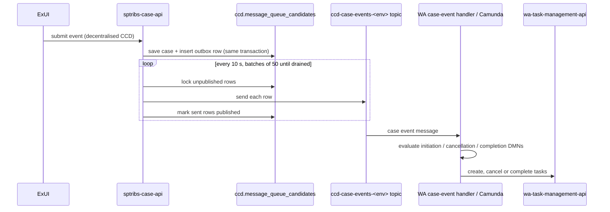

# Work Allocation

This service feeds Work Allocation (WA) by publishing CCD case events to the shared CCD Service Bus topic `ccd-case-events-<env>`. WA, not this service, evaluates the DMN decision tables and creates, completes and cancels tasks. This page explains how events reach WA, what the six DMN files decide, how they are deployed, and how WA runs in PR previews. For the step-by-step recipe, see [adding-a-work-allocation-task.md](adding-a-work-allocation-task.md).

In summary:

- `caseEventServiceBus = true` in the `ccd { }` block of [`build.gradle`](../build.gradle) adds the SDK's `ccd-servicebus-support` module. Events are written to an outbox table, `ccd.message_queue_candidates`, and a scheduler in this service sends them. The connection string comes from the Key Vault secret `ccd-case-events-sendonly-connection-string`. This service can only **send** to the topic.
- Only events whose definition calls `publishToCamunda()` are published. On master, 28 event classes do.
- Six DMN files live in [`src/main/resources/dmn/`](../src/main/resources/dmn/): initiation, completion, cancellation, configuration, permissions and types. All are for `st_cic` / `criminalinjuriescompensation`. They define 67 task types across four role categories: `ADMIN`, `LEGAL_OPERATIONS`, `JUDICIAL` and `CTSC`.
- [`Jenkinsfile_CNP`](../Jenkinsfile_CNP) uploads the DMNs and the WA BPMN to Camunda in AAT, prod, demo, perftest, ithc, and in previews that have the `pr-values:wa` label.
- PR previews run without WA unless the PR has the `pr-values:wa` label. `pr-values:wa-ft-tests` also runs the WA functional tests.

## How events reach Work Allocation

This is a decentralised CCD service. Its `build.gradle` declares:

```groovy
ccd {
  configDir = file('ccd-definitions/definitions')
  decentralised = true
  caseEventServiceBus = true
}
```

`decentralised = true` routes CCD callbacks for `CriminalInjuriesCompensation` to this service. `caseEventServiceBus = true` makes the SDK Gradle plugin add the `ccd-servicebus-support` module, which publishes case events onto Azure Service Bus for the WA pipeline. The plugin marks this flag as deprecated in favour of declaring `implementation 'com.github.hmcts:ccd-servicebus-support'` directly. Both do the same thing.



### The outbox

Publishing is a transactional outbox. The code that runs it is in the CCD SDK ([ccd-config-generator](https://github.com/hmcts/ccd-config-generator)), not in this repo.

1. **On submit.** The decentralised runtime's `MessagePublisher` checks whether the event is marked for publishing. In the SDK, `publishToCamunda()` on an event sets `Publish = Y` on the event and on every field on its pages, except fields with the `Complex` display context. If the event is marked, the runtime inserts a row into `ccd.message_queue_candidates` with `message_type = 'CASE_EVENT'`. The insert runs in the same database transaction that saves the case. Events that are not marked are skipped.
2. **On the schedule.** `CcdCaseEventScheduler` calls `CcdCaseEventPublisher` on the Spring cron below. Each batch runs in its own transaction. It selects up to the batch size of unpublished rows in timestamp order, with `FOR UPDATE SKIP LOCKED` so that replicas don't send the same row twice. It sends each row, then sets `published` on the rows that were sent. Batches repeat until a batch comes back short.
3. **Housekeeping.** After each run, rows that were published more than the retention period ago are deleted.

The payload is CCD's `MessageInformation` JSON, the same shape CCD data-store publishes: `UserId`, `JurisdictionId`, `CaseTypeId`, `CaseId`, `EventTimeStamp`, `EventInstanceId`, `EventId`, `PreviousStateId`, `NewStateId` and `AdditionalData`. `AdditionalData` holds `Data` (the published fields) and `Definition`. The publisher also copies `JurisdictionId`, `CaseTypeId`, `CaseId` and `EventId` into the JMS properties `jurisdiction_id`, `case_type_id`, `case_id` and `event_id`. It sets `JMSXGroupID` to the case ID, so messages for one case share a Service Bus session.

Failure handling, in the SDK major version that `build.gradle` pins (6.x):

- **At startup.** When `spring.jms.servicebus.enabled` is `true`, `CcdServiceBusConnectionValidator` opens a producer on the topic. If that fails, for example because the topic is missing, the credentials lack Send, or the connection string is the `dummy` fallback, the application fails to start.
- **At send time.** Sending is asynchronous to the callback, so a send failure never reaches the user's event submission. A row that fails to send is logged and stays unpublished, and the next run retries it. If no row in a batch sends, the run logs an error and stops until the next tick. Later rows in a batch can still be sent after an earlier one fails, so ordering within a case is not guaranteed while a failure lasts. Newer SDK majors lock each case's earliest unpublished message and skip that case for the rest of the run after a failed send.

These `ccd.servicebus.*` keys in [`application.yaml`](../src/main/resources/application.yaml) control publishing:

| Setting | Env var | sptribs default | SDK default |
|---|---|---|---|
| Topic | `CCD_SERVICEBUS_DESTINATION`, then `AZURE_SERVICE_BUS_TOPIC_NAME` | `ccd-case-events-aat` | none |
| Scheduler on/off | `SPTRIBS_SERVICEBUS_SCHEDULER_ENABLED` | `true` | `false` |
| Batch size | `SPTRIBS_SERVICEBUS_BATCH_SIZE` | `50` | `100` |
| Schedule (Spring cron) | `SPTRIBS_SERVICEBUS_SCHEDULE` | `*/10 * * * * *` | `*/10 * * * * *` |
| Retention of published rows (days) | `SPTRIBS_SERVICEBUS_PUBLISHED_RETENTION_DAYS` | `7` | `90` |

The JMS client itself is controlled by `spring.jms.servicebus.enabled`, which `application.yaml` sets to `true`. The publisher, the validator and the JMS configuration only load when it is `true`. The scheduler needs both it and `ccd.servicebus.scheduler-enabled`. The connection string comes from `AZURE_SERVICE_BUS_CONNECTION_STRING`, or `AZURE_SERVICE_BUS_PREVIEW_CONNECTION_STRING` in preview. If neither is set, the fallback is `dummy`. The Helm chart [`values.yaml`](../charts/sptribs-case-api/values.yaml) sets `CCD_SERVICEBUS_DESTINATION` to `ccd-case-events-{{ .Values.global.environment }}`, so each environment publishes to its own topic. The local `bootWithCCD` and `cftlibTest` tasks set `SPRING_JMS_SERVICEBUS_ENABLED=false`.

### Send-only access

[sptribs-shared-infrastructure](https://github.com/hmcts/sptribs-shared-infrastructure) does not create the Service Bus namespace or topic. In `servicebus.tf` it reads CCD's existing namespace `ccd-servicebus-<env>` (resource group `ccd-shared-<env>`) and topic `ccd-case-events-<env>` as data sources. It then adds one authorisation rule:

- `azurerm_servicebus_topic_authorization_rule.ccd_case_events_topic_send`, named `sptribs-sendonly`, with `listen = false`, `send = true` and `manage = false`.
- The rule's primary connection string goes into the `sptribs-<env>` Key Vault as `ccd-case-events-sendonly-connection-string`.
- This service's chart maps that secret to `AZURE_SERVICE_BUS_CONNECTION_STRING`.

This service is a publisher only. It cannot read from the topic, and this repo defines no subscription. WA owns the consumer side. If CCD's namespace or topic is missing in an environment, the data-source lookup fails and the Terraform apply fails with it.

### Per-environment switches

Environment overlays live in [cnp-flux-config](https://github.com/hmcts/cnp-flux-config) under `apps/sptribs/sptribs-case-api/<env>.yaml`.

| Env | Overlay settings | Effective publishing |
|---|---|---|
| AAT | `SPRING_JMS_SERVICEBUS_ENABLED=true`, `SPTRIBS_SERVICEBUS_SCHEDULER_ENABLED=true`, `WA_FEATURE_ENABLED=true` | On |
| Prod | `SPRING_JMS_SERVICEBUS_ENABLED=true`, `SPTRIBS_SERVICEBUS_SCHEDULER_ENABLED=true` | On |
| Demo | `WA_FEATURE_ENABLED=true`. `TASK_MONITOR_API_URL`, `TASK_MANAGEMENT_API_URL` and `ROLE_ASSIGNMENT_API_URL` point at Demo services | On (application defaults) |
| Perftest | `WA_FEATURE_ENABLED=true` | On (application defaults) |
| ITHC | `WA_FEATURE_ENABLED=true` | On (application defaults) |
| Preview | [`values.preview.template.yaml`](../charts/sptribs-case-api/values.preview.template.yaml) sets `SPRING_JMS_SERVICEBUS_ENABLED=false`. [`values.wa.preview.template.yaml`](../charts/sptribs-case-api/values.wa.preview.template.yaml) (`pr-values:wa`) turns both flags back on | Off, unless `pr-values:wa` |

Neither the Helm chart nor the demo, perftest and ithc overlays set the two Service Bus flags, so the `true` defaults in `application.yaml` apply there. No code in this service reads `WA_FEATURE_ENABLED` or `ROLE_ASSIGNMENT_API_URL`.

## The DMN files

All six are Camunda DMN decision tables under [`src/main/resources/dmn/`](../src/main/resources/dmn/). This service never evaluates them. They are deployed to WA's Camunda, and WA evaluates them against each incoming case event.

| File | Decides |
|---|---|
| `wa-task-initiation-st_cic-criminalinjuriescompensation.dmn` | Which tasks an event creates |
| `wa-task-cancellation-st_cic-criminalinjuriescompensation.dmn` | Which open tasks an event cancels |
| `wa-task-completion-st_cic-criminalinjuriescompensation.dmn` | Which tasks an event completes |
| `wa-task-configuration-st_cic-criminalinjuriescompensation.dmn` | Task attributes: case name, location, region, priority, due-date calculation, work type, role category and the description links into ExUI |
| `wa-task-permissions-st_cic-criminalinjuriescompensation.dmn` | Which roles can see, claim and complete each task |
| `wa-task-types-st_cic-criminalinjuriescompensation.dmn` | The catalogue of task type codes and names |

### Initiation inputs and outputs

The initiation table takes these inputs from the event and from `additionalData.Data`:

- `eventId`
- `postEventState`
- `referralType`, from `cicCaseReferralTypeForWA`
- `adminActionRequired`, from `cicCaseAdminActionRequired`
- `firstOrderDueDate`, which is true when `cicCaseFirstOrderDueDate` is set

Each matching rule outputs `taskId`, `name`, `delayUntil`, `workingDaysAllowed`, `processCategories`, `workType` and `roleCategory`. One event can create several tasks.

Here is one rule as an example:

| Input | Value |
|---|---|
| `eventId` | `create-draft-order` |
| `postEventState` | `CaseManagement` or `ReadyToList` |
| `referralType` | `Withdrawal request` |
| **Output** `taskId` | `processCaseWithdrawalDirections` |
| **Output** `name` | Process case withdrawal directions |
| **Output** `workType` | `routine_work` |
| **Output** `workingDaysAllowed` | `7` |
| **Output** `processCategories` | `Processing` |
| **Output** `roleCategory` | `ADMIN` |

The initiation table has 63 rules, and each one creates a different task type. These events trigger them:

- `create-draft-order`, `refer-to-legal-officer` and `refer-to-judge`, keyed on state and referral type
- `create-and-send-order` and `caseworker-send-order`
- `create-hearing-summary`
- `caseworker-case-built`
- `edit-case`
- `citizen-cic-submit-dss-application`
- `citizen-cic-dss-update-case`, `caseworker-document-management` and `respondent-document-management`
- `system-trigger-stitch-collate-hearing-bundle` and `system-trigger-complete-hearing-outcome`

Events such as `caseworker-issue-decision`, `contact-parties` and `caseworker-cancel-hearing` don't create tasks. They appear only in the completion or cancellation tables.

### Task types and role categories

`wa-task-types` lists 67 task types. That is the 63 created by initiation, plus four `reviewSpecificAccessRequest*` types that WA creates when someone requests specific access to a case. The configuration table assigns each type a role category, and the initiation output agrees with it.

| Role category | Count | Task types |
|---|---|---|
| `ADMIN` | 28 + 1 | `processCaseWithdrawalDirections`, `processCaseWithdrawalDirectionsListed`, `processRule27Decision`, `processRule27DecisionListed`, `processListingDirections`, `processListingDirectionsListed`, `processDirectionsReListedCase`, `processDirectionsReListedCaseWithin5Days`, `processSetAsideDirections`, `processCorrections`, `processDirectionsReturned`, `processPostponementDirections`, `processTimeExtensionDirectionsReturned`, `processReinstatementDecisionNotice`, `processOtherDirectionsReturned`, `processWrittenReasons`, `processStrikeOutDirectionsReturned`, `processStayDirections`, `processStayDirectionsListed`, `processFurtherEvidence`, `issueDecisionNotice`, `completeHearingOutcome`, `issueCaseToRespondent`, `vetNewCaseDocuments`, `registerNewCase`, `followUpNoncomplianceOfDirections`, `stitchCollateHearingBundle`, `reviewOrder`; plus `reviewSpecificAccessRequestAdmin` |
| `LEGAL_OPERATIONS` | 16 + 1 | The `review…LO` types: `reviewNewCaseAndProvideDirectionsLO`, `reviewTimeExtensionRequestLO`, `reviewStrikeOutRequestLO`, `reviewStayRequestLO`, `reviewStayRequestCaseListedLO`, `reviewListingDirectionsLO`, `reviewListingDirectionsCaseListedLO`, `reviewWithdrawalRequestLO`, `reviewWithdrawalRequestCaseListedLO`, `reviewRule27RequestLO`, `reviewRule27RequestCaseListedLO`, `reviewListCaseLO`, `reviewListCaseWithin5DaysLO`, `reviewPostponementRequestLO`, `reviewReinstatementRequestLO`, `reviewOtherRequestLO`; plus `reviewSpecificAccessRequestLegalOps` |
| `JUDICIAL` | 19 + 1 | The `review…Judge` types (the same 16 as the `review…LO` types, with a `Judge` suffix), plus `reviewCorrectionsRequest`, `reviewWrittenReasonsRequest` and `reviewSetAsideRequest`; plus `reviewSpecificAccessRequestJudiciary` |
| `CTSC` | 0 + 1 | `reviewSpecificAccessRequestCTSC` only |

The permissions table grants these roles:

- **`ADMIN` tasks:** `regional-centre-admin`, `regional-centre-team-leader`, `hearing-centre-admin`, `hearing-centre-team-leader`, `ctsc` and `ctsc-team-leader`. CTSC staff work on admin tasks even though no task is initiated with the `CTSC` role category.
- **`LEGAL_OPERATIONS` tasks:** `senior-tribunal-caseworker` and `tribunal-caseworker`.
- **`JUDICIAL` tasks:** `senior-judge` and `judge`, with authorisation `328`. `leadership-judge` gets only the judiciary access-request task.
- **Every task:** `task-supervisor`.

No permission rule is auto-assignable.

### Points to remember

- **An event only reaches WA if it calls `publishToCamunda()`.** Unmarked events are never written to the outbox, so a new event that should create or close a task needs the flag.
- **A DMN input must be a field on a page of the publishing event.** `additionalData.Data` carries only the fields that have `Publish = Y`, and the SDK sets that only for fields on the event's pages. A missing field gives an unmatched rule, not an error. For example, `cicCaseReferralTypeForWA` feeds the referral-type input. It is set by the refer-to-judge and refer-to-legal-officer events and by the create-draft-order and create-new-order pages.
- **The three lifecycle tables are independent.** A task can be completed or cancelled by an event that was not written with that task in mind. Check `completion` and `cancellation` whenever you add an event.
- **The Camunda external-task client on the classpath is not used for DMN evaluation.** `build.gradle` declares `camunda-external-task-client`, but no class in `src/main/java` imports anything from `org.camunda`. The Camunda engine dependencies are test-scoped and run the DMN unit tests.

## WA REST URLs

`application.yaml` also sets two WA URLs:

- `wa_task_monitor_api.url` (`TASK_MONITOR_API_URL`)
- `wa_task_management_api.url` (`TASK_MANAGEMENT_API_URL`)

No code in `src/main` calls either. Only the functional-test helpers in [`src/functionalTest/java/uk/gov/hmcts/sptribs/testutil/`](../src/functionalTest/java/uk/gov/hmcts/sptribs/testutil/) use them: `TaskManagementService` searches, claims and completes tasks, and `TaskMonitorService` triggers the task-monitor jobs. Task lifecycle is driven entirely by the DMNs that WA evaluates.

Draft PR [#2467](https://github.com/hmcts/sptribs-case-api/pull/2467) proposes moving task decisions into Java event handlers that write to a task outbox, in place of the Service Bus and DMN route. It is not merged. This page describes master.

## Deploying the DMNs

| Route | Where | What |
|---|---|---|
| `Jenkinsfile_CNP`, master build | AAT | `before('functionalTest:aat')` calls `uploadDmnDiagrams()` and `uploadBpmnDiagram()` against `camunda-api-aat` |
| `Jenkinsfile_CNP`, master build | Prod | `afterSuccess('functionalTest:aat')` switches to the prod Camunda and the prod S2S secret, then uploads again |
| `Jenkinsfile_CNP`, PR build | Preview | `afterSuccess('akschartsinstall')`, only with the `pr-values:wa` label. Uploads to the PR's own Camunda, then runs `setup-role-assignments.sh` |
| `Jenkinsfile_CNP`, environment branches | demo, perftest, ithc | `afterSuccess('checkout')` uploads in that environment's subscription. The pipeline syncs these branches with master |
| [`bin/wa/deploy-demo-dmn.sh`](../bin/wa/deploy-demo-dmn.sh) | Demo | Manual wrapper. Reads the S2S secret from `sptribs-demo` and calls `import-dmn-diagram.sh` |
| [`bin/wa/import-dmn-diagram.sh`](../bin/wa/import-dmn-diagram.sh) | Any (`CAMUNDA_BASE_URL`) | Posts each `.dmn` to `/engine-rest/deployment/create` with tenant `st_cic` and `deploy-changed-only=true` |
| [`bin/wa/import-wa-bpmn-diagram.sh`](../bin/wa/import-wa-bpmn-diagram.sh) | Any (`CAMUNDA_BASE_URL`) | Posts each `.bpmn` that the pull script fetched |
| [`bin/wa/pull-latest-camunda-wa-files.sh`](../bin/wa/pull-latest-camunda-wa-files.sh) | Pipeline / local | Clones [wa-standalone-task-bpmn](https://github.com/hmcts/wa-standalone-task-bpmn) at the given branch (the pipeline uses `master`) and copies its resources |
| [`bin/wa/setup-role-assignments.sh`](../bin/wa/setup-role-assignments.sh) | Preview | Calls the PR's `am-org-role-mapping-service` `/am/testing-support/createOrgMapping` for the users in `aat-caseworker-user-ids.json` |

Both import scripts log a failed upload and carry on, so a DMN that Camunda rejects does not fail the build. Check the stage log after changing a DMN.

## WA in PR previews

By default, preview deployments run without WA, because `values.preview.template.yaml` sets `SPRING_JMS_SERVICEBUS_ENABLED: false`. These labels change that:

| Label | Effect |
|---|---|
| `pr-values:wa` | Deploys the PR with WA pods, using `values.wa.preview.template.yaml` |
| `pr-values:wa-ft-tests` | Runs the WA functional tests. Needs `pr-values:wa` too |

For preview, cnp-flux-config includes Azure Service Operator resources for a sptribs Service Bus (`sptribs-servicebus`) in `apps/sptribs/preview/base/kustomization.yaml`. This is separate from CCD's shared namespace. With `pr-values:wa`, this service takes its connection string from the `sptribs-sb-preview` secret and publishes to `${SERVICE_NAME}-asb-ccd-case-events`.

The WA functional tests run when `WA_FUNCTIONAL_TESTS_ENABLED=true`. The pipeline sets that when the PR has `pr-values:wa-ft-tests`, and it raises `maxParallelForks` from half the available processors to all of them. They use WA IDAM users from Key Vault (`wa-seniorCaseworker-username` / `-password` and `wa-regionalHearingCentreTeamLead-username` / `-password`).

## WA scheduled tasks

The tasks under [`systemupdate/schedule/wa`](../src/main/java/uk/gov/hmcts/sptribs/systemupdate/schedule/wa/) are system events that exist to trigger WA rules. They run as Kubernetes CronJobs (Helm chart `sptribs-cron`) from this service's image. `TASK_NAME` names the bean, and `ScheduledTaskRunner` runs it. See [scheduled-tasks.md](scheduled-tasks.md) for the general mechanism.

| Task (`TASK_NAME`) | What it does | Cron job | Schedule | Envs |
|---|---|---|---|---|
| `SystemTriggerStitchCollateHearingBundleTask` | Finds `AwaitingHearing` cases with a hearing date within 14 days and no `stitchHearingBundleTask=Yes`, then submits `SYSTEM_TRIGGER_STITCH_COLLATE_HEARING_BUNDLE` | `sptribs-cron-trigger-stitch-hearing-bundle` | `0 8 * * 1-5` | Demo, AAT |
| `SystemTriggerCompleteHearingOutcomeTask` | Finds `AwaitingHearing` cases with a hearing date of today and no `completeHearingOutcomeTask=Yes`, then submits `SYSTEM_TRIGGER_COMPLETE_HEARING_OUTCOME` | `sptribs-cron-trigger-complete-hearing-outcome` | `0 8 * * 1-5` | Demo, AAT |

Both events call `publishToCamunda()` and set their `…Task` flag to `Yes`, so each case triggers once. Both tasks catch `CcdConflictException` (another run is in progress) and `CcdSearchCaseException` rather than failing. A failed submit for one case is logged and the loop moves on. Both tasks submit as the IDAM system-update user.

Neither cron job is in the prod, perftest or ithc kustomizations. In those environments the `stitchCollateHearingBundle` and `completeHearingOutcome` tasks are not created, because their only initiation events come from these jobs.

To run a task locally:

```bash
TASK_NAME=SystemTriggerStitchCollateHearingBundleTask ./gradlew bootRun
```

## See also

- [Adding a work allocation task](adding-a-work-allocation-task.md): the step-by-step recipe
- [Case lifecycle](case-lifecycle.md): which events publish to WA and the states they lead to
- [Roles and access](roles-and-access.md): the roles that claim and complete WA tasks
- [Architecture](architecture.md): where WA fits in the system
- [Configuration](configuration.md): environment variables for Service Bus and DMN deployment
